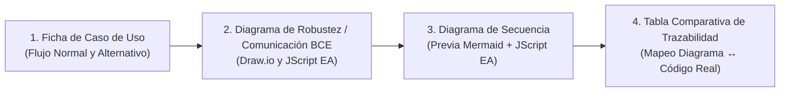

# 📐 Estándar Oficial de Diagramas UML (ICONIX / UML 2.5+ / BCE)
### FashionStore — Plataforma E-Commerce SaaS Multitenant

Este documento define las reglas estrictas de modelado, diseño visual, nomenclatura, estructura relacional y sintaxis técnica para generar **Fichas de Casos de Uso**, **Diagramas de Robustez (BCE / Comunicación)** en Draw.io y Enterprise Architect (JScript), **Diagramas de Secuencia** en Enterprise Architect (JScript) con vista previa Mermaid, y la **Tabla Comparativa de Trazabilidad Código $\leftrightarrow$ Diagrama** bajo la metodología **ICONIX** y el estándar académico **UML 2.5+**.

> **PRIORIDAD DEL PROCESO:**  
> 1. **Ficha de Caso de Uso** (Requisitos y flujo de pasos)  
> 2. **Diagrama de Robustez (BCE / Comunicación)** (Draw.io `.drawio` y JScript EA `.js`)  
> 3. **Diagrama de Secuencia** (Previa Mermaid en chat + Script JScript EA `.js`)  
> 4. **Tabla de Trazabilidad Código $\leftrightarrow$ Diagrama**  
> *(Los diagramas de clases VOPC quedan descartados de la entrega Draw.io y sólo se emiten como revisión opcional en Mermaid si el usuario lo pide explícitamente).*

---

## 1. 🏛️ Metodología ICONIX y Fundamentos BCE

En la metodología **ICONIX** y en el marco académico unificado:
- El **Diagrama de Robustez** y el **Diagrama de Comunicación BCE** representan la misma vista estructural de colaboración de objetos del caso de uso.
- El diagrama va de la mano con el **Diagrama de Secuencia**: **ambos comparten exactamente los mismos participantes y la misma numeración jerárquica de mensajes (`1:`, `1.1:`, `2:`, etc.)**.
- Permite modelar escenarios distribuidos y multinivel que requieran **múltiples Fronteras (Boundaries)** (ej. vista web, componente seguro Stripe Elements, modal de confirmación) y **múltiples Controladores (Controllers)** (ej. controller de pagos web/móvil y servicio de órdenes backend).



### 1.1. Fuente de Verdad para la Elaboración de Diagramas

* **Caso de Uso ya Implementado (Fuente Primaria: Código Real):**  
  La elaboración de los diagramas se realiza con **total fidelidad a partir del código implementado en el repositorio**:
  - Endpoints y routers de FastAPI (`backend/app/packages/pX_.../routes/...` o `backend/app/routes/...`).
  - Servicios de aplicación y dominio (`backend/app/packages/pX_.../services/...` o `backend/app/services/...`).
  - Esquemas Pydantic y validaciones de entrada (`schemas/`).
  - Modelos SQLAlchemy y tablas PostgreSQL (`backend/app/models/...` y migraciones `alembic/`).
  - Vistas y componentes web en Angular 21 (`frontend/src/app/...`) o pantallas móviles Flutter (`mobile/lib/...`).
* **Caso de Uso No Implementado (Diseño Previo Riguroso):**  
  Si el CU **aún no está codificado**, se diagraman como un **plan de implementación previo exhaustivo**, tomando como fuentes de verdad obligatorias:
  - Documentos de Casos de Uso y Políticas: [`docs/ACTORS_AND_USE_CASES.md`](file:///c:/Users/PERSONAL/ecommerce-SI2/docs/ACTORS_AND_USE_CASES.md) y [`docs/BUSINESS_POLICIES.md`](file:///c:/Users/PERSONAL/ecommerce-SI2/docs/BUSINESS_POLICIES.md).
  - Arquitectura y Módulos: [`docs/ARCHITECTURE.md`](file:///c:/Users/PERSONAL/ecommerce-SI2/docs/ARCHITECTURE.md) y [`docs/OFFLINE_AND_SYNC.md`](file:///c:/Users/PERSONAL/ecommerce-SI2/docs/OFFLINE_AND_SYNC.md).
  - Checklist oficial de fases: [`docs/ai/IMPLEMENTATION_PHASES.md`](file:///c:/Users/PERSONAL/ecommerce-SI2/docs/ai/IMPLEMENTATION_PHASES.md).

---

### 1.2. Patrón Canónico Horizontal BCE y Reglas Sagradas de Interconexión

Todo flujo de robustez debe respetar el patrón horizontal:

```text
[Actor(es)] ──► [Boundary(ies)] ──► [Controller(s)] ──► [Entidades de Dominio]
```

### ⚠️ Reglas Sagradas de Interconexión:
1. **Actores:** Solo pueden comunicarse directamente con objetos **Boundary** (Frontera/Interfaz). Jamás se conectan directo a un Controller ni a una Entity.
2. **Boundary (Interfaz / Frontera):** Solo se comunica con **Actores** y con objetos **Controlador**. Jamás se conecta directamente a una Entity.
3. **Control (Controlador / Lógica):** 
   - Es el orquestador del caso de uso. Se comunica con Boundaries, con otros Controllers (ej. Controller local/gateway $\rightarrow$ Servicio Backend) y con Entities.
   - **Regla Estricta del Proyecto (AGENTS.md):** Los bucles (*loops*), las validaciones lógicas de negocio y los flujos alternativos parten **SIEMPRE desde el objeto Controlador**.
4. **Entity (Entidad / Modelo de Datos):** 
   - Solo se comunica con objetos **Controlador**.
   - Las entidades **NUNCA** se envían mensajes entre sí en los diagramas de interacción/robustez.
   - Las entidades **NUNCA** devuelven respuestas a otras entidades ni se conectan a Boundaries.

---

## 2. 📋 Ficha de Caso de Uso (Fase 1 ICONIX)

Cada Caso de Uso debe contar con su ficha estructurada previa antes del modelado de robustez y secuencia:

```markdown
### CUxx: [Nombre del Caso de Uso]
* **Actor Principal:** [Ej. Cliente, Vendedor POS, Cajero]
* **Precondición:** [Estado requerido del sistema antes de iniciar]
* **Flujo Normal:**
  1. El actor solicita/inicia la acción en la interfaz...
  2. La interfaz envía la solicitud al controlador...
  3. El controlador valida...
  4. El controlador consulta/actualiza la entidad...
  5. El sistema confirma y presenta el resultado.
* **Flujos Alternativos:**
  - 3a. [Condición de fallo / regla de negocio]: El controlador detecta error, rechaza la operación y notifica a la interfaz.
* **Postcondición:** [Estado resultante persistido en base de datos].
```

---

## 3. 🛡️ Diagrama de Robustez (BCE / Comunicación)

El Diagrama de Robustez (también denominado Diagrama de Comunicación BCE) muestra la colaboración topológica de objetos con flujo numerado de mensajes (`1:`, `1.1:`, `2:`, etc.). Se elabora en **dos formatos oficiales**:
1. **Archivo Draw.io (`.drawio`)**: Guardado en `docsUML/CUrobustez/CUxx_comm_[nombre].drawio`.
2. **Script JScript WSH (`.js`) para Enterprise Architect**: Guardado en `docsUML/CUrobustez/CUxx_comm_[nombre]_EA.js`.

### 3.1. Simbología Canónica BCE:
* **Boundary (`shape=umlBoundary`):** Círculo con barra vertical a la izquierda (`|O`). Representa pantallas, modales, formularios web o vistas móviles.
* **Control (`shape=umlControl`):** Círculo con flecha curva superior derecha (`((↺))`). Representa controladores y servicios.
* **Entity (`shape=umlEntity`):** Círculo con barra inferior horizontal (`( )`). Representa tablas o modelos de datos.

### 3.2. Estándar de Diseño Gráfico en Draw.io (`.drawio`)
1. **Flecha Gráfica Separada Arriba de Cada Mensaje:**
   - Cada mensaje se compone de **dos celdas (`mxCell`) independientes**:
     1. Celda de texto para la etiqueta del método: `1.1: verificarConexion()`.
     2. Celda tipo arista/flecha (`edge="1"`) posicionada **directamente encima de la celda de texto**, orientada en la dirección de la invocación.
2. **Regla Estricta de Texto en Negro:**  
   El texto de todos los métodos permanece **SIEMPRE en color negro (`fontColor=#000000`)**.
3. **Diferenciación Cromática de Flujos (Únicamente en Flechas):**
   - **Flujo 1 (Principal / Listado / Apertura):** Azul Marino Oscuro (`strokeColor=#003366`) o Negro (`strokeColor=#000000`).
   - **Flujo 2 (Creación / Registro / Proceso Core / Reconexión):** Verde Bosque Oscuro (`strokeColor=#005522`).
   - **Flujo 3 (Actualización / Pago / Sincronización):** Púrpura / Morado Oscuro (`strokeColor=#4B0082`).
   - **Flujo 4 (Inspección / Detalle / Auditoría):** Azul Marino Oscuro (`strokeColor=#003366`).
   - **Flujo 5 (Anulación / Error / Flujo Alternativo):** Rojo Óxido Oscuro (`strokeColor=#8B0000`).
4. **Posición Respecto a la Línea de Relación:**
   - Invocaciones hacia adelante: **ARRIBA** de la línea continua de relación con flecha continua (`endArrow=classic`).
   - Retornos de Datos: **ABAJO** de la línea de relación con flecha discontinua (`dashed=1;`) orientada de regreso hacia el emisor.
5. **Validaciones y Bucles en Controller:**  
   Auto-relación reflexiva curva sobre el Controller con los mensajes de validación apilados a un costado.

### 3.3. Estándar para JScript (Enterprise Architect — Comunicación / Robustez)
* **Directorio de salida:** Guardado en `docsUML/CUrobustez/CUxx_comm_[nombre]_EA.js`.
* **Archivo de Referencia Canónico:** [`docsUML/CUrobustez/CU09_comm_comprar_prendas_stripe_EA.js`](file:///c:/Users/PERSONAL/ecommerce-SI2/docsUML/CUrobustez/CU09_comm_comprar_prendas_stripe_EA.js) (copiado también como plantilla en `.agents/skills/uml-academic-diagrams/examples/CU09_comm_comprar_prendas_stripe_EA.js`).

#### ⚠️ REGLA DE ORO DE ICONOS BCE EN ENTERPRISE ARCHITECT (INVIOLABLE):
En la API de automatización de Enterprise Architect, para que el motor gráfico dibuje los **iconos circulares canónicos BCE** (círculo con barra vertical `|O`, círculo con flecha superior `((↺))`, círculo con barra horizontal inferior `( )_`), el tipo de elemento **DEBE SER OBLIGATORIAMENTE `"Object"` (Instancia)**:
* ✅ **CORRECTO:**
  - Actores: `pkg.Elements.AddNew("NombreActor", "Actor")`
  - Boundary: `pkg.Elements.AddNew("NombreBoundary", "Object")` con `Stereotype = "boundary"`
  - Control: `pkg.Elements.AddNew("NombreControl", "Object")` con `Stereotype = "control"`
  - Entity: `pkg.Elements.AddNew("NombreEntity", "Object")` con `Stereotype = "entity"`
* ❌ **PROHIBIDO:** Usar `tipo = "Boundary"`, `tipo = "Control"` o `tipo = "Entity"`. Si se hace esto, Enterprise Architect dibuja cajas rectangulares genéricas con texto de estereotipo o clases cuadradas amarillas en lugar de los iconos circulares nativos.

#### Función Canónica de Creación y Purga Atómica:
Para evitar que elementos creados previamente con un tipo incorrecto persistan en la base de datos de EA, la función debe verificar si existe y, de tener un tipo diferente a `"Object"`, eliminarlo y recrearlo:
```javascript
function crearElementoConEsterotipo(pkg, name, tipo, estereotipo) {
    for (var i = pkg.Elements.Count - 1; i >= 0; i--) {
        var el = pkg.Elements.GetAt(i);
        if (el.Name == name) {
            if (el.Type == tipo) {
                if (estereotipo && el.Stereotype != estereotipo) {
                    el.Stereotype = estereotipo;
                    el.Update();
                }
                return el;
            } else {
                pkg.Elements.Delete(i);
                pkg.Elements.Refresh();
                break;
            }
        }
    }
    var newEl = pkg.Elements.AddNew(name, tipo);
    if (estereotipo && estereotipo.length > 0) {
        newEl.Stereotype = estereotipo;
    }
    newEl.Update();
    pkg.Elements.Refresh();
    return newEl;
}
```

#### Dimensiones Cuadradas (80x80 px):
Para que Enterprise Architect dibuje círculos perfectos sin aplastamiento ni distorsión, las coordenadas espaciales deben ser estrictamente cuadradas ($80 \times 80$ px):
```javascript
// Izquierda, Derecha (L + 80), Arriba, Abajo (Top - 80)
colocarElemento(diagram, bndComponent, 180, 260, -180, -260);
```

#### Actualización y Apertura Automática:
Al finalizar el script, guardar, recargar y abrir el diagrama automáticamente:
```javascript
diagram.Update();
Repo.SaveDiagram(diagram.DiagramID);
Repo.ReloadDiagram(diagram.DiagramID);
try { Repo.OpenDiagram(diagram.DiagramID); } catch(ex) {}
```

---

## 4. 🎬 Diagrama de Secuencia (Fase 3 ICONIX — JScript Enterprise Architect)

El Diagrama de Secuencia detalla la dimensión temporal y asignación formal de métodos en las líneas de vida de los objetos, guardado en `docsUML/CUSecuencia/CUxx_secuencia_[nombre]_EA.js`.

### 4.1. Previsualización Obligatoria en Mermaid
**REGLA OBLIGATORIA:** Antes de emitir el script JScript para Enterprise Architect, el agente debe presentar en el chat una **vista previa completa en sintaxis Mermaid** del Diagrama de Secuencia, permitiendo al usuario inspeccionar de inmediato el flujo, participantes y fragmentos `alt`/`loop`.

### 4.2. Especificaciones Técnicas del Script JScript (Enterprise Architect)
* **Entorno:** Enterprise Architect 15.0+ (Motor JScript WSH).
* **Participantes (Lifelines) Distribuidos Horizontalmente:**
  - `<<Actor>>`, `<<Boundary>>`, `<<Controller>>`, `<<Entity>>`.
  - Cajas rectangulares estándar con el **color por defecto de Enterprise Architect** (sin estilos personalizados).
  - Trazado de **línea de vida (lifeline)** visible y continua.
* **⚠️ CONVENCIÓN DE PARÁMETROS (INVIOLABLE):**
  - Todas las funciones y métodos en los mensajes deben escribirse **ESTRICTAMENTE SIN PARÁMETROS**:
    - ✅ Correcto: `iniciarCheckout()`, `crearIntentoPago()`, `procesarCobro()`, `actualizarOrden()`
    - ❌ Prohibido: `iniciarCheckout(items, total)`, `crearIntentoPago(orderId, amount)`
* **Validaciones Centralizadas en el Controller:**  
  Toda regla de validación lógica se modela como mensaje reflexivo (`self-call` del Controller).
* **Fragmentos Combinados UML 2.5+ (`alt`, `loop`, `opt`):**
  - Delimitación obligatoria en comentarios antes de cada bloque en JScript:
    ```javascript
    // FRAGMENTO ALT [Guardia / Condicion]: Abarca desde Mensaje X.X hasta Y.Y
    // FRAGMENTO LOOP [Iteracion]: Abarca desde Mensaje Z.1 hasta Z.N
    // FRAGMENTO OPT [Condicion]: Abarca Mensaje W.W
    ```
  - Máximo 3 fragmentos `alt` por diagrama para preservar legibilidad.

---

## 5. 📋 Requisito Post-Diagramación: Tabla de Trazabilidad Código ↔ Diagrama

**REGLA OBLIGATORIA DE ENTREGA:** Tras diagramar el Caso de Uso (Robustez + Secuencia), el agente **DEBE EMITIR OBLIGATORIAMENTE EN SU RESPUESTA** una tabla comparativa de trazabilidad que vincule los elementos modelados con su implementación real en el código:

| Estereotipo | Objeto en Diagrama | Función Diagramada `metodo()` | Ubicación en Código Fuente | Método / Endpoint Real |
| :--- | :--- | :--- | :--- | :--- |
| `<<Actor>>` | `Cliente` | `iniciarCheckout()` | `frontend/src/app/...` | Evento de usuario en UI |
| `<<Boundary>>` | `:CheckoutPageComponent` | `seleccionarMetodo()` | `frontend/src/app/checkout/...` | Componente Checkout Angular |
| `<<Controller>>` | `:PaymentRoutes` | `stripe_checkout_route()` | `backend/app/packages/p4_.../routes/payment_routes.py` | `POST /payments/stripe/checkout` |
| `<<Controller>>` | `:OrderService` | `create_stripe_payment()` | `backend/app/packages/p4_.../services/order_service.py` | `create_stripe_payment()` |
| `<<Entity>>` | `:Order` | `commit()` | `backend/app/models/order.py` | Modelo SQLAlchemy `Order` |

---

## 6. 🚫 Regla de Memoria Multi-Agente para Diagramas

Al trabajar exclusivamente en la generación, corrección o documentación de diagramas (`.drawio`, `.js` en `docsUML/`, `.puml`, `.md` de diagramas):
* **NO crear sesiones en `docs/ai/sessions/`.**
* **NO modificar los archivos de relevo (`CURRENT_STATE.md`, `HANDOFF_LATEST.md`, `NEXT_STEPS.md`).**
* La memoria viva persistente (`docs/ai/sessions/`) se reserva de forma estricta para modificaciones en el código fuente, lógica de negocio o esquema de base de datos del sistema.
