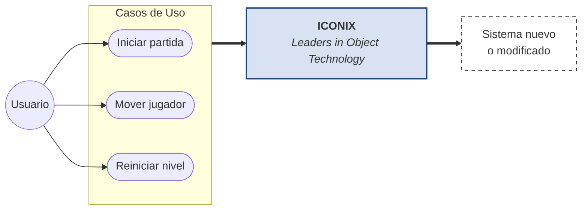
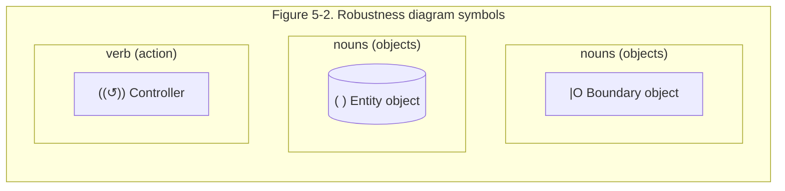
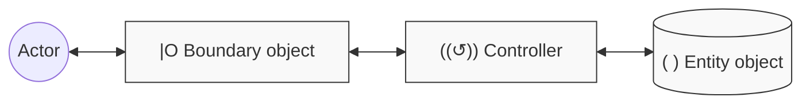
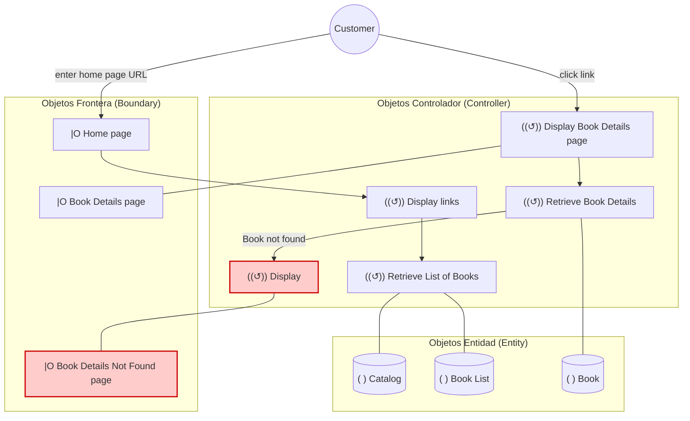
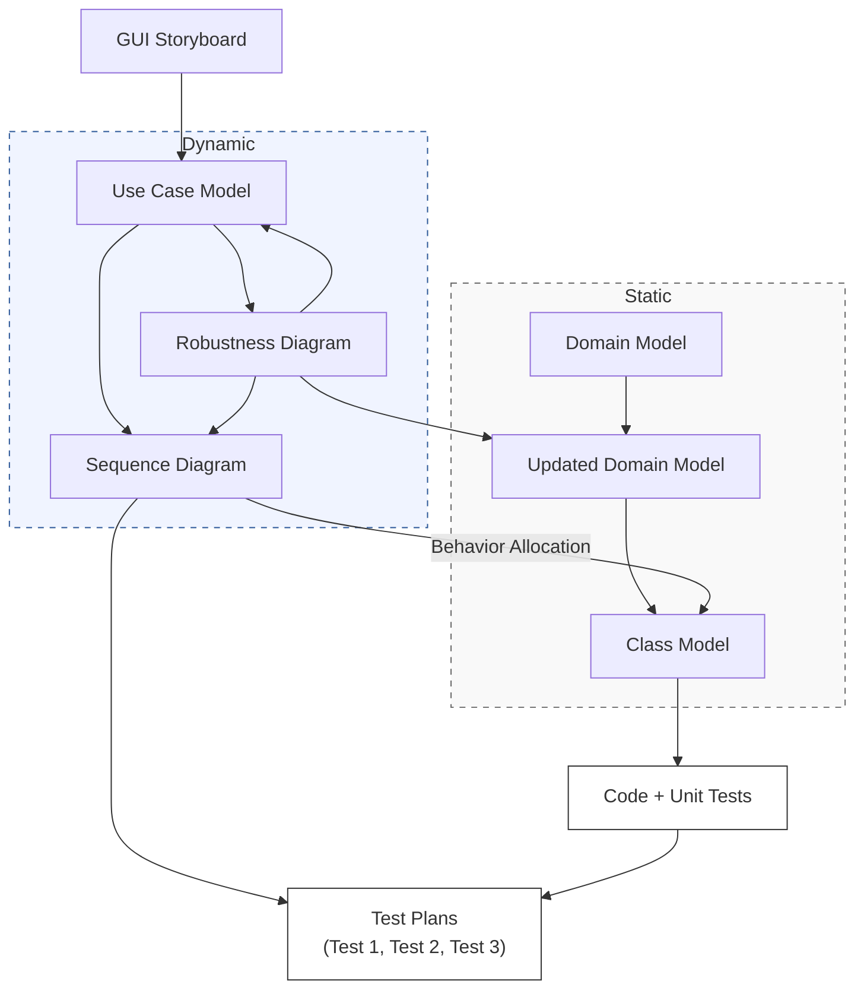

# Manual Introductorio de Iconix:

## 1 - ¿Qué es Iconix?

**ICONIX**

*Leaders in Object Technology*

Iconix es una metodología pesada-ligera de Desarrollo del Software que se halla a medio camino entre un **RUP** **(Rational Unified Process)** y un **XP (eXtreme Programming)**.

Iconix deriva directamente del RUP y su fundamento es el hecho de que un 80% de los casos pueden ser resueltos tansolo con un uso del 20% del UML, con lo cual se simplifica muchísimo el proceso sin perder documentación al dejar solo aquello que es necesario. Esto implica un uso dinámico del UML de tal forma que siempre se pueden utilizar otros diagramas además de los ya estipulados si se cree conveniente.

Iconix se guía a través de casos de uso y sigue un ciclo de vida iterativo e incremental. El objetivo es que a partir de los casos de uso se obtenga el sistema final.

*NOTA: Esta representación es puramente orientativa, los casos de uso pertenecen al proceso Iconix.*

El objetivo de esto es que cada requisito se identifique con algún caso de uso, tal que podamos verificar en cualquier momento que por parte del sistema ese requisito se satisface y su funcionalidad es correcta (**trazabilidad**). Así pues, obtenemos una medida tangible de calidad.

Decimos que un sistema es de **calidad** basándonos en la proporción de requisitos que éste satisface. Así pues, un sistema poseerá calidad si **satisface** sus **requisitos**.

## 2- Las fases de Iconix:

Iconix se estructura en cuatro fases. La primera de ellas es el análisis de requisitos, seguida del análisis y diseño preliminar, a continuación viene el diseño y finaliza con su implementación.

Previamente a esto, sin embargo, deberemos realizar un pequeño storyboard de la interfaz gráfica, con dibujos de las pantallas principales del sistema a partir de las reuniones con el cliente.

### 1) Análisis de Requisitos:

En esta primera fase se realiza un Modelo de Dominio, que no es más que un Diagrama de Clases extremadamente simplificado. Este modelo contiene únicamente aquellos objetos de la vida real cuyo comportamiento o datos deban ser almacenados en el sistema.

A partir de este pequeño modelo, se realiza un pequeño prototipo basándose en la storyboard de la interfaz gráfica obtenida previamente, el cual se mostrará al cliente y se refinará en sucesivas reuniones. Normalmente este prototipo suele converger en dos o tres iteraciones.

Una vez el prototipo ya es final y se han obtenido todos los requisitos del sistema por parte del cliente, se procede a realizar los casos de uso. Estos diagramas de casos de uso se agrupan en diagramas de paquetes (es decir, utilizan referencias entre diagramas de casos de uso para simplificar su lectura) y se asocia cada requisito a un caso de uso para obtener la ya mencionada anteriormente trazabilidad.

### 2) Análisis y Diseño Preliminar:

A partir de cada caso de uso se obtienen sus correspondientes fichas de caso de uso. Cabe destacar que estas fichas no pertenecen al UML. He aquí un ejemplo de ficha para que se entienda mejor:

* **Nombre:** Crear mensaje foro

* **Autor:** Joaquin Gracia

* **Fecha:** 24/08/2003

* **Descripción:** Permite crear un mensaje en el foro de discusión.

* **Actores:** Usuario de Internet logeado.

* **Precondiciones:** El usuario debe haberse logeado en el sistema.

* **Flujo Normal:**

  1. El actor pulsa sobre el botón para crear un nuevo mensaje.

  2. El sistema muestra una caja de texto para introducir el título del mensaje y una zona de mayor tamaño para introducir el cuerpo del mensaje.

  3. El actor introduce el título del mensaje y el cuerpo del mismo.

  4. El sistema comprueba la validez de los datos y los almacena.

* **Flujo Alternativo:**
  4. El sistema comprueba la validez de los datos, si los datos no son correctos, se avisa al actor de ello permitiéndole que los corrija

* **Poscondiciones:** El mensaje ha sido almacenado en el sistema.

La ficha está formada por un nombre, que suele ser el del caso de uso, posee una breve descripción (generalmente en vista usuario, es decir, que hace de forma intuitiva, no como), una precondición que debe cumplir antes de iniciarse, una postcondición que debe cumplir al terminar si termina correctamente, un flujo normal que sigue el sistema en caso de que todo vaya correctamente y un flujo alternativo en caso de que haya cualquier problema. El resto de campos son opcionales.

Después será necesario realizar lo que se conoce como Diagrama de Robustez, el cual pertenece al proceso Iconix y tampoco forma parte del UML. A continuación describiremos como se realiza un diagrama de este tipo.

Los elementos de un diagrama de robustez son los Objetos Frontera, los Objetos Entidad y los Objetos Controlador. Los dos primeros se relacionan con sustantivos y el último con verbos.

Cabe destacar el hecho de que esto funciona como una frase. Los sustantivos se relacionan a través de verbos. Por ejemplo:

> *Índice, muestra enlace, libro.*
>
> El primero es frontera, el segundo controlador y el tercero entidad.

Así pues, se establece el siguiente flujo:

Hay una excepción, y es que los objetos de tipo Controlador pueden comunicarse entre ellos.

A continuación se muestra un diagrama de robustez a modo de ejemplo:

El objetivo del diagrama de robustez es añadir nuevas relaciones a los diagramas de clase, de forma que ya tendremos un esqueleto aceptable de la arquitectura y del diseño a partir del cual podremos proseguir nuestro proceso. Con esto y las fichas, refinamos el diagrama de clases tanto como sea necesario y obtenemos una nueva versión preparada para la siguiente fase.

### 3) Diseño:

En esta fase se proceden a realizar los diagramas de secuencia, los cuales derivan directamente de las fichas de caso de uso. Obsérvese como, los diagramas de secuencia se relacionan con fichas de caso de uso que se relacionan con casos de uso que se relacionan con requisitos. Esto implica que una vez finalizado el diseño, tras refinar nuevamente el diagrama de clases, podremos verificarlo directamente gracias a este factor de trazabilidad, y prepararnos para la siguiente fase.

En caso de que no estemos satisfechos con el resultado, será necesario repasar todo el proceso hasta que éste sea correcto. Es vital que los requisitos se satisfagan correctamente para el éxito del proyecto.

### 4) Implementación:

De cara a poder distribuir el software correctamente, puede ser adecuado realizar un diagrama de componentes en algunos casos, pero no siempre es necesario. En cualquier caso, aquí es donde se escribe el código tal y como fue especificado en las fases anteriores y se planean las pruebas basándonos en los requisitos iniciales, al nivel que fuese necesario.

Aquí es donde hacemos uso real de la trazabilidad y donde realmente ponemos en práctica esa garantía de calidad que tanto hemos mencionado. Después de tener un buen diseño, es cuestión de crear un buen software a partir de ese diseño, y mediante los testeos y pruebas adecuados podemos garantizar que el sistema final cumple con los requisitos iniciales y por tanto proceder a su entrega.

## 5 - Resumen del proceso:

A través de reuniones con el cliente se genera una storyboard de la interfaz mediante la cual, realizando prototipos y un modelo de dominio, obtenemos el visto bueno para la recogida final de requisitos. Estos se representan como casos de uso y sus respectivas fichas de caso de uso asociadas. Con ello se realiza un diagrama de robustez el cual refinará nuestro diagrama de clases.

Las fichas de caso de uso derivan en diagramas de secuencia y en un nuevo y último refinamiento del diagrama de clases. A partir de este diseño completo, se obtiene el código y mediante el factor de trazabilidad a partir de los requisitos iniciales planeamos y creamos los tests necesarios.

Una vez hayamos terminado este proceso, reiterando en cada paso las veces que sean necesarias, dispondremos de un software de calidad (que satisface los requisitos) listo para entregar al cliente.

## 6- Referencias:

* http://iconixprocess.files.wordpress.com/2007/01/showbookdetails-robustness.png

* http://www.portalhuarpe.com.ar/Seminario09/archivos/MetodologiaICONIX.pdf

* http://www.portalhuarpe.com.ar/Seminario09/archivos/UsodeICONIX.pdf