# CATÁLOGO DE ACTORES Y CASOS DE USO (ICONIX)
### FashionStore — Plataforma SaaS Multitenant E-Commerce
**Metodología:** ICONIX Process (UML 2.5+)  
**Alcance Oficial:** 25 Casos de Uso Definitivos (Consolidados para el 2do Parcial)  
**Normativa:** Pliego Oficial de Requisitos y Directrices de Cátedra (Sistemas 2 - 2026)

---

## 1. Clasificación Oficial de Actores del Sistema

El modelado ICONIX define a los actores como entidades externas que interactúan con las fronteras del sistema, categorizándolos en **Actores Principales (Humanos)** y **Actores Secundarios / del Sistema (Recursos Externos y Procesos Background)**:

### 1.1. Actores Principales (Usuarios del Sistema)

| Actor | Rol y Responsabilidad en el Negocio | Plataforma |
| :--- | :--- | :--- |
| **Superadministrador (`Superadmin`)** | Administrador global de la infraestructura SaaS. Registra empresas (*tenants*), gestiona planes de suscripción (Básico con 3 sucursales, Profesional con 10 y Empresarial), asigna cuotas comerciales y supervisa el aislamiento y métricas de la plataforma. | Web (Portal Master SaaS) |
| **Administrador de Tienda (`Tenant Admin`)** | Propietario o gerente de la empresa contratante. Administra sus sucursales físicas dentro del límite de su plan, gestiona el catálogo global de prendas con variantes de talla y precio diferenciado, configura políticas de cambio/devolución y consulta reportes analíticos con IA y Machine Learning. | Web (Panel de Administración) |
| **Encargado de Sucursal (`Branch Manager`)** | Responsable operativo de una tienda física particular. Resuelve reservas de prendas expiradas, concilia ventas offline en conflicto por quiebres de inventario central y supervisa la disponibilidad de existencias de su sede. | Web / Móvil (App Gerencial) |
| **Cajero / Vendedor (`Cashier`)** | Personal de punto de venta físico en sucursal. Opera el POS en modo conectado o en contingencia desconectada (**offline**), efectúa cobros exclusivamente en efectivo en modo sin red con UUIDv4, gestiona la bandeja outbox de pendientes, ejecuta cambios de prenda por talla cobrando la diferencia y procesa devoluciones con retención (20%-50%) emitiendo Notas de Crédito. | Web (PWA POS) / Móvil POS |
| **Cliente (`Customer`)** | Usuario final comprador. Navega por el catálogo online o en caché offline (IndexedDB / SQLite), filtra prendas por talla y precio, realiza compras digitales con tarjeta mediante Stripe, genera reservas de stock (online u offline) con vencimiento de 24h-48h y visualiza rutas hacia las sucursales con OpenStreetMap. | Web (Tienda Online PWA) / Móvil (App Cliente) |

---

### 1.2. Actores Secundarios / del Sistema (Recursos y Servicios Externos)

| Actor | Naturaleza | Función en el Sistema |
| :--- | :--- | :--- |
| **Backend API (`Backend API`)** | Servidor Central | Ejecuta las reglas de negocio, forzado de aislamiento multitenant por `tenant_id`, cálculo de diferencias de precio, verificación de idempotencia y persistencia transaccional en PostgreSQL. |
| **Motor de Sincronización (`Sync Engine`)** | Proceso Background | Tarea asíncrona en cliente (PWA Service Worker / Mobile Background Task) que detecta la recuperación de conectividad a Internet y despacha lotes de ventas pendientes (`PENDIENTE_SYNC`) hacia `/api/sales/offline/batch-sync`. |
| **Pasarela de Pagos Stripe (`Stripe Gateway`)** | Servicio Externo | Procesa cobros con tarjeta en tiempo real, tokeniza credenciales financieras y notifica la confirmación definitiva (`paid`) mediante webhooks criptográficos para habilitar el despacho de mercadería (Política 3). |
| **Servicio de Mapas y Rutas (`OpenStreetMap / ORS`)** | API Externa | Provee teselas de mapas abiertas para renderizado vectorial en Flutter y resuelve el trazado de rutas de navegación física (a pie o vehículo) desde la ubicación GPS del cliente hacia la sucursal más cercana. |
| **Módulo de Inteligencia Artificial (`AI & ML Service`)** | Motor Analítico | Procesa audio y texto mediante la API de Google Gemini para responder consultas ejecutivas por voz (RAG), y ejecuta algoritmos Scikit-Learn (Supervisado de demanda y No Supervisado K-Means) sobre datasets sintéticos de moda. |

---

## 2. Matriz de Trazabilidad: Casos de Uso vs Requisitos Funcionales

| Paquete | Código | Nombre Oficial del Caso de Uso | Tipo | Requisitos Funcionales Abarcados |
| :--- | :---: | :--- | :---: | :--- |
| **`p0`** | **`CU01`** | **Registrar y Gestionar Empresas (Tenants)** | Nuevo 2P | RF-01 (Alta tenant), RF-02 (Aislamiento de datos) |
| **`p0`** | **`CU02`** | **Gestionar Planes de Suscripción (Básico, Pro, Empresarial) y Cuotas** | Nuevo 2P | RF-03 (Catálogo de planes), RF-04 (Límites comerciales) |
| **`p1`** | **`CU03`** | **Iniciar Sesión Multitenant con JWT y Claims de Tenant** | Modificado 1P | RF-05 (Autenticación JWT), RF-06 (Inyección tenant_id/rol) |
| **`p1`** | **`CU04`** | **Gestionar Sucursales Bajo Límites del Plan** | Modificado 1P | RF-07 (CRUD Sucursales), RF-08 (Validación cuota 3 vs 10) |
| **`p2`** | **`CU05`** | **Gestionar Prendas y Variantes de Precio por Talla** | Modificado 1P | RF-11 (CRUD Prendas), RF-12 (Precios diferenciados talla) |
| **`p2`** | **`CU06`** | **Consultar Catálogo Online con Búsqueda Facetada** | Modificado 1P | RF-13 (Filtro categorías), RF-14 (Filtro facetado multicriterio) |
| **`p3`** | **`CU07`** | **Sincronizar y Descargar Catálogo a Almacenamiento Local (PWA / SQLite)**| Nuevo 2P | RF-15 (Descarga offline pack), RF-16 (Persistencia local IDB/SQLite) |
| **`p3`** | **`CU08`** | **Consultar Catálogo Offline en Modo Desconectado** | Nuevo 2P | RF-17 (Renderizado sin red), RF-18 (Degradación elegante caché) |
| **`p4`** | **`CU09`** | **Comprar Prendas con Stripe y Despacho Condicionado** | Modificado 1P | RF-23 (Carrito de compra), RF-24 (Despacho contra pago Stripe) |
| **`p4`** | **`CU10`** | **Crear Reserva Online de Prendas con Vencimiento y Bloqueo** | Modificado 1P | RF-25 (Apartado stock online), RF-26 (Temporizador caducidad) |
| **`p4`** | **`CU11`** | **Registrar Reserva de Prendas Offline en Modo Desconectado (PWA / SQLite)**| Nuevo 2P | RF-27 (Reserva sin conexión), RF-28 (UUID local + cola sync) |
| **`p4`** | **`CU12`** | **Atender y Resolver Conflictos de Reservas Expiradas** | Nuevo 2P | RF-29 (Liberación automática), RF-30 (Resolución colisiones) |
| **`p5`** | **`CU13`** | **Registrar Venta POS Desconectada en Efectivo con Contingencia UUIDv4** | Nuevo 2P | RF-31 (Venta contingencia), RF-32 (UUIDv4 + Efectivo contado) |
| **`p5`** | **`CU14`** | **Gestionar Bandeja Local de Operaciones Pendientes (Outbox PWA / SQLite)** | Nuevo 2P | RF-33 (Bandeja outbox), RF-34 (Inspección y reintento sync) |
| **`p5`** | **`CU15`** | **Sincronizar Lotes de Ventas con Idempotencia Central (`sync_operations`)**| Nuevo 2P | RF-35 (Batch sync), RF-36 (Idempotencia sin duplicados) |
| **`p5`** | **`CU16`** | **Gestionar y Resolver Conflictos de Ventas Offline y Quiebres de Stock** | Nuevo 2P | RF-37 (Detección quiebre central), RF-38 (Nota crédito/Sustituto) |
| **`p5`** | **`CU17`** | **Procesar Cambio de Prenda por Talla con Cobro de Diferencia y Estado** | Nuevo 2P | RF-39 (Cambio talla), RF-40 (Abono diferencia + Etiqueta) |
| **`p5`** | **`CU18`** | **Procesar Devolución de Prenda con Retención Operativa y Nota de Crédito** | Nuevo 2P | RF-41 (Devolución parcial), RF-42 (Nota de Crédito digital) |
| **`p6`** | **`CU19`** | **Localizar Sucursales y Trazar Rutas (OpenStreetMap / ORS)** | Nuevo 2P | RF-43 (Renderizado mapas), RF-44 (Cálculo trayecto ORS) |
| **`p6`** | **`CU20`** | **Generar Reportes Ejecutivos por Voz y Lenguaje Natural (Gemini RAG)** | Nuevo 2P | RF-45 (Entrada/Salida voz), RF-46 (RAG contextual tenant) |
| **`p6`** | **`CU21`** | **Exportar Reportes Empresariales a Formatos PDF y Excel** | Modificado 1P | RF-47 (Plantillas PDF dinámicas), RF-48 (Planillas Excel) |
| **`p6`** | **`CU22`** | **Generar Dataset Sintético de Ventas y Estacionalidad** | Nuevo 2P | RF-49 (Generador estocástico), RF-50 (Patrones moda textil) |
| **`p6`** | **`CU23`** | **Predecir Demanda de Ropa (ML Supervisado)** | Nuevo 2P | RF-51 (Regresión RandomForest), RF-52 (Inferencia de ventas) |
| **`p6`** | **`CU24`** | **Segmentar Clientes con K-Means (ML No Supervisado)** | Nuevo 2P | RF-53 (Clustering K-Means), RF-54 (Perfiles RFM + Devolución) |
| **`p6`** | **`CU25`** | **Visualizar Dashboard Ejecutivo con KPIs y Métricas ML** | Modificado 1P | RF-55 (Métricas tiempo real), RF-56 (Gráficos analíticos ML) |

---

## 3. Matriz de Trazabilidad: Casos de Uso vs Tablas de Base de Datos (PostgreSQL)

Mapeo estricto contra el esquema central consolidado en la migración `0044_complete_database_schema_all_use_cases.py`:

| Paquete | Código | Nombre del Caso de Uso | Tablas de Base de Datos Involucradas | Columnas y Claves Críticas de Negocio |
| :--- | :---: | :--- | :--- | :--- |
| **`p0`** | **CU01** | Registrar y Gestionar Empresas (Tenants) | `companies`, `subscriptions`, `plans` | `subdomain`, `nit_rut`, `status`, `tenant_id` |
| **`p0`** | **CU02** | Gestionar Planes y Cuotas | `plans`, `subscriptions`, `companies` | `max_branches` (3 vs 10), `has_ai_access`, `price_monthly` |
| **`p1`** | **CU03** | Iniciar Sesión Multitenant con JWT | `users`, `companies`, `branches` | Claims JWT (`sub`, `rol`, `tenant_id`, `branch_id`), hash BCrypt |
| **`p1`** | **CU04** | Gestionar Sucursales Bajo Límites del Plan | `branches`, `companies`, `subscriptions` | `tenant_id`, `is_default`, `latitude`, `longitude`, conteo vs plan |
| **`p2`** | **CU05** | Gestionar Prendas y Variantes Talla/Precio | `products`, `product_variants`, `sizes`, `colors` | `tenant_id`, `sku` compuesto, `price` por variante, `image_url` |
| **`p2`** | **CU06** | Consultar Catálogo Online Facetado | `products`, `product_variants`, `categories` | Filtros dinámicos indexados (`category_id`, `size_id`, `color_id`) |
| **`p3`** | **CU07** | Sincronizar y Descargar Catálogo Local | `catalog_cache`, `products`, `product_variants`, `inventory` | `tenant_id`, `version`, snapshot JSON estructurado para IndexedDB |
| **`p3`** | **CU08** | Consultar Catálogo Offline Desconectado | `catalog_cache` (Frontend IDB / SQLite) | Lectura local en almacén `catalog_products` y `catalog_variants` |
| **`p4`** | **CU09** | Comprar Prendas con Stripe y Despacho | `orders`, `order_items`, `carts`, `cart_items` | `tenant_id`, `payment_status = 'paid'`, `tracking_number`, `dispatched_at` |
| **`p4`** | **CU10** | Crear Reserva Online con Vencimiento | `reservations`, `reservation_items`, `inventory` | `tenant_id`, `reservation_code`, `expires_at`, bloqueo en `reserved_quantity` |
| **`p4`** | **CU11** | Registrar Reserva Offline Desconectada | `reservations`, `sync_operations` (Local IDB) | `client_reservation_id UUID`, `sync_status = 'PENDIENTE_SYNC'` |
| **`p4`** | **CU12** | Atender Conflictos de Reservas Expiradas | `reservations`, `reservation_items`, `inventory` | `tenant_id`, `resolved_at`, `resolved_by`, `resolution_note`, liberación |
| **`p5`** | **CU13** | Venta POS Desconectada en Efectivo UUID | `sales`, `sale_items` (Local IDB / SQLite) | `client_sale_id UUID`, `payment_method = 'EFECTIVO'`, `is_offline = TRUE` |
| **`p5`** | **CU14** | Gestionar Bandeja Local de Pendientes | `sync_operations` (Frontend IDB / SQLite) | Listado outbox de tickets con estado `PENDIENTE_SYNC` |
| **`p5`** | **CU15** | Sincronizar Ventas con Idempotencia | `sync_operations`, `sales`, `sale_items`, `inventory` | `client_operation_id UNIQUE`, verificación contra doble inserción |
| **`p5`** | **CU16** | Resolver Conflictos de Ventas Offline | `sales`, `inventory`, `inventory_movements` | `sync_status = 'EN_CONFLICTO'`, stock negativo o nota de crédito |
| **`p5`** | **CU17** | Cambio de Prenda por Talla y Cobro | `garment_exchanges`, `sales`, `product_variants`, `inventory`| `price_difference`, `difference_paid`, inspección de etiqueta |
| **`p5`** | **CU18** | Devolución con Retención y Nota Crédito | `garment_returns`, `sales`, `product_variants`, `inventory` | `retention_rate` (20%-50%), `refund_amount`, `credit_note_code` |
| **`p6`** | **CU19** | Rutas y Tiendas en OpenStreetMap | `branches` | `latitude`, `longitude`, consulta OpenRouteService en Flutter |
| **`p6`** | **CU20** | Reportes Ejecutivos por Voz (Gemini RAG)| `conversations`, `conversation_messages`, `sales`, `inventory` | `tenant_id`, audio transcription, respuesta multimodal y TTS |
| **`p6`** | **CU21** | Exportar Reportes a PDF y Excel | `sales`, `inventory`, `orders`, `branches` | Agregación dinámica de balances y exportación en streaming |
| **`p6`** | **CU22** | Generar Dataset Sintético de Ventas | `ml_models` | Generación estocástica de 10,000+ registros con estacionalidad |
| **`p6`** | **CU23** | Predecir Demanda Ropa (Supervisado) | `demand_forecasts`, `ml_models`, `product_variants` | RandomForestRegressor ($R^2 \ge 0.82$), proyecciones a 4 semanas |
| **`p6`** | **CU24** | Segmentar Clientes con K-Means | `customer_segments`, `ml_models`, `users` | Clustering RFM + Devoluciones (Clusters VIP, Ocasión, Riesgo) |
| **`p6`** | **CU25** | Dashboard Ejecutivo con KPIs y ML | `demand_forecasts`, `customer_segments`, `sales`, `orders` | Visualización reactiva en tiempo real con gráficos y métricas SaaS |

---

## 4. Diagrama General de Casos de Uso (UML 2.5+)

```mermaid
flowchart TB
    subgraph Actores_Principales["Actores Principales (Usuarios)"]
        SA["Superadministrador"]
        TA["Tenant Admin"]
        BM["Encargado Sucursal"]
        CA["Cajero / Vendedor"]
        CU["Cliente"]
    end

    subgraph Actores_Sistema["Actores Secundarios / del Sistema"]
        API["Backend API"]
        SYNC["Sync Engine"]
        STRIPE["Pasarela Stripe"]
        MAPS["OpenStreetMap / ORS"]
        AI["Módulo IA & ML"]
    end

    subgraph P0_P1["P0 & P1: SaaS, Usuarios y Acceso"]
        CU01(["CU01: Empresas Tenants"])
        CU02(["CU02: Planes (Básico 3 suc.)"])
        CU03(["CU03: Login JWT Multitenant"])
        CU04(["CU04: Sucursales bajo Cuota"])
    end

    subgraph P2["P2: Catálogo y Prendas"]
        CU05(["CU05: Prendas y Precios Talla"])
        CU06(["CU06: Catálogo Online Facetado"])
    end

    subgraph P3["P3: Inventario y Modo Offline"]
        CU07(["CU07: Descarga Catálogo IDB/SQLite"])
        CU08(["CU08: Catálogo Offline PWA/Móvil"])
    end

    subgraph P4["P4: Compras y Reservas"]
        CU09(["CU09: Compra Stripe con Despacho"])
        CU10(["CU10: Reserva Online Vencimiento"])
        CU11(["CU11: Reserva Offline Desconectada"])
        CU12(["CU12: Conflictos Reservas Expiradas"])
    end

    subgraph P5["P5: POS, Sincronización y Políticas"]
        CU13(["CU13: Venta Offline Efectivo UUID"])
        CU14(["CU14: Bandeja Outbox Pendientes"])
        CU15(["CU15: Sync Idempotente por Lotes"])
        CU16(["CU16: Conflictos Ventas Offline"])
        CU17(["CU17: Cambio Prenda Diferencia"])
        CU18(["CU18: Devolución con Nota Crédito"])
    end

    subgraph P6["P6: IA, ML y Geolocalización"]
        CU19(["CU19: Rutas OpenStreetMap"])
        CU20(["CU20: Reportes Voz Gemini RAG"])
        CU21(["CU21: Exportar Reportes PDF/Excel"])
        CU22(["CU22: Dataset Sintético"])
        CU23(["CU23: Predicción Demanda"])
        CU24(["CU24: Segmentación K-Means"])
        CU25(["CU25: Dashboard KPIs y ML"])
    end

    SA --> CU01
    SA --> CU02
    TA --> CU03
    TA --> CU04
    TA --> CU05
    TA --> CU20
    TA --> CU21
    TA --> CU22
    TA --> CU23
    TA --> CU24
    TA --> CU25

    BM --> CU12
    BM --> CU16

    CA --> CU07
    CA --> CU08
    CA --> CU13
    CA --> CU14
    CA --> CU15
    CA --> CU17
    CA --> CU18

    CU --> CU03
    CU --> CU06
    CU --> CU07
    CU --> CU08
    CU --> CU09
    CU --> CU10
    CU --> CU11
    CU --> CU19

    CU09 -.-> STRIPE
    CU15 -.-> SYNC
    CU15 -.-> API
    CU19 -.-> MAPS
    CU20 -.-> AI
    CU23 -.-> AI
    CU24 -.-> AI
```

---

## 5. Especificación Formal de los 25 Casos de Uso (ICONIX)

> **Regla Sagrada ICONIX:** Las pantallas y vistas son Fronteras (`<<boundary>>`), los modelos son Entidades (`<<entity>>`) y las validaciones, ciclos y bifurcaciones parten **SIEMPRE del objeto Controlador (`<<control>>`)**, jamás de una Frontera.

---

### Paquete 0 & 1: Plataforma SaaS y Control de Acceso (`p0` / `p1`)

#### CU01: Registrar y Gestionar Empresas (Tenants)
- **Actores:** Superadministrador (Principal), Backend API (Secundario).
- **Tipo:** Nuevo del 2do Parcial.
- **Plataforma:** Web (Portal Master SaaS).
- **Precondición:** Superadmin autenticado en la plataforma global.
- **Flujo Normal:**
  1. El Superadmin accede al panel de tenants y presiona "Registrar Nueva Empresa".
  2. Ingresa razón social, NIT/RUT, subdominio/slug único y datos de contacto.
  3. Marca el checkbox obligatorio de aceptación de Términos del Servicio SaaS y cuotas.
  4. El Controlador valida la unicidad de NIT y slug en la base de datos central.
  5. El Controlador solicita a la Entidad `Company` la creación del registro con estado `ACTIVO`.
  6. La Frontera despliega la notificación de éxito y refresca la grilla de empresas.
- **Flujos Alternativos:**
  - *4. A1:* Slug o NIT ya registrado $\rightarrow$ El Controlador bloquea la acción y la Frontera solicita corregir el dato duplicado.
- **Postcondición:** Empresa registrada con identificador `tenant_id` universal para aislamiento lógico.

#### CU02: Gestionar Planes de Suscripción y Cuotas Comerciales
- **Actores:** Superadministrador (Principal), Backend API (Secundario).
- **Tipo:** Nuevo del 2do Parcial.
- **Plataforma:** Web (Portal Master SaaS).
- **Precondición:** Empresas dadas de alta en el sistema.
- **Flujo Normal:**
  1. El Superadmin selecciona una empresa y pulsa "Gestionar Plan".
  2. Selecciona entre **Plan Básico (máx. 3 sucursales)**, **Plan Profesional (máx. 10 sucursales con IA)** o **Plan Empresarial (ilimitadas con backup continuo)**.
  3. El Controlador calcula la vigencia (mensual/anual) y actualiza la cuota máxima permitida en `Subscription`.
  4. El Controlador persiste los límites y actualiza los flags de módulos habilitados.
  5. La Frontera confirma la asignación del plan.
- **Flujos Alternativos:**
  - *3. A1 [Downgrade Guard]:* Si la empresa tiene 5 sucursales activas e intenta degradar a Básico (máx. 3), el Controlador bloquea la acción hasta desactivar las sucursales excedentes.
- **Postcondición:** Cuotas comerciales vigentes a nivel de base de datos.

#### CU03: Iniciar Sesión Multitenant con JWT y Claims de Tenant
- **Actores:** Todos los roles (Principales), Backend API (Secundario).
- **Tipo:** Modificado del 1er Parcial.
- **Plataforma:** Web / Móvil.
- **Precondición:** Usuario registrado en una empresa tenant o como superadmin.
- **Flujo Normal:**
  1. El usuario ingresa email y contraseña en la pantalla de autenticación.
  2. El Controlador busca al usuario por email y verifica el hash de la contraseña (BCrypt).
  3. Si es usuario de empresa, el Controlador verifica que la empresa tenga estado `ACTIVO`.
  4. El Controlador genera el token JWT firmado con claims: `sub (user_id)`, `rol`, `tenant_id` y `branch_id`.
  5. La Frontera guarda el token en almacenamiento seguro y redirige al panel según su rol.
- **Flujos Alternativos:**
  - *2. A1:* Credenciales incorrectas $\rightarrow$ Controlador responde HTTP 401.
  - *3. A2:* Empresa suspendida por mora $\rightarrow$ Controlador responde HTTP 403 con aviso de suspensión.
- **Postcondición:** Sesión autenticada con contexto multitenant inmutable.

#### CU04: Gestionar Sucursales Bajo Límites del Plan
- **Actores:** Tenant Admin (Principal), Backend API (Secundario).
- **Tipo:** Modificado del 1er Parcial.
- **Plataforma:** Web.
- **Precondición:** Tenant Admin autenticado en su empresa.
- **Flujo Normal:**
  1. El administrador ingresa a "Sucursales" y solicita crear una nueva tienda física.
  2. Ingresa nombre, ciudad, dirección, coordenadas GPS (latitud/longitud), teléfono y horario.
  3. El Controlador cuenta las sucursales activas actuales de la empresa en `Branch`.
  4. El Controlador compara la cantidad contra la cuota permitida por su plan (`max_branches`: 3, 10 o ilimitado).
  5. Al haber cupo disponible, el Controlador persiste la sucursal asignando su `tenant_id`.
  6. La Frontera actualiza la lista y dibuja el widget de consumo de cuota (ej. 2/3 activas).
- **Flujos Alternativos:**
  - *4. A1:* Cuota copada (ej. 3 de 3 en Básico) $\rightarrow$ El Controlador bloquea con HTTP 403 y la Frontera sugiere subir a Plan Profesional.
- **Postcondición:** Sucursal operativa respetando los límites contractuales del SaaS.

---

### Paquete 2: Catálogo de Productos y Prendas (`p2`)

#### CU05: Gestionar Prendas y Variantes de Precio por Talla
- **Actores:** Tenant Admin (Principal), Backend API (Secundario).
- **Tipo:** Modificado del 1er Parcial.
- **Plataforma:** Web.
- **Precondición:** Tenant Admin con permisos de catálogo.
- **Flujo Normal:**
  1. El administrador ingresa a "Catálogo" y selecciona "Crear Prenda".
  2. Define nombre, categoría, descripción, material y fotos.
  3. En la matriz de variantes, agrega tallas (S, M, L, XL) y asigna precios diferenciados por talla (ej. Talla M a Bs 50, Talla L a Bs 70).
  4. El Controlador valida la unicidad de SKU compuesto y precios positivos.
  5. El Controlador guarda el producto en `Product` y sus variantes en `ProductVariant` asociadas al `tenant_id`.
  6. La Frontera muestra la prenda con su tabla de precios diferenciados.
- **Flujos Alternativos:**
  - *4. A1:* SKU colisiona $\rightarrow$ Controlador solicita corregir el código SKU.
- **Postcondición:** Catálogo con precios por talla listo para políticas de cambio y venta.

#### CU06: Consultar Catálogo Online con Búsqueda Facetada
- **Actores:** Cliente (Principal), Backend API (Secundario).
- **Tipo:** Modificado del 1er Parcial.
- **Plataforma:** Web / Móvil.
- **Precondición:** Conexión a Internet activa y tienda pública accesible.
- **Flujo Normal:**
  1. El cliente accede a la tienda virtual de la boutique.
  2. Aplica filtros facetados: Categoría (Vestidos), Talla (M), Rango de Precios (Bs 50 - Bs 100).
  3. El Controlador backend ejecuta la consulta optimizada con índices compuestos en PostgreSQL.
  4. La Frontera renderiza la grilla de prendas con fotos, tallas y rango de precios disponibles.
- **Postcondición:** Prendas filtradas según las preferencias del comprador.

---

### Paquete 3: Inventario y Disponibilidad Offline (`p3`)

#### CU07: Sincronizar y Descargar Catálogo a Almacenamiento Local (PWA / SQLite)
- **Actores:** Cliente, Cajero (Principales), Sync Engine, Backend API (Secundarios).
- **Tipo:** Nuevo del 2do Parcial.
- **Plataforma:** Web PWA / Móvil Flutter.
- **Precondición:** Conexión a Internet activa al momento de la sincronización.
- **Flujo Normal:**
  1. La aplicación inicia o el usuario pulsa "Sincronizar Catálogo Offline".
  2. El Controlador cliente solicita al endpoint `/api/catalog/offline-pack?branch_id={uuid}` el lote estructurado.
  3. El Controlador backend extrae productos, variantes, tallas, precios y existencias netas de la sucursal.
  4. El cliente recibe el payload JSON y abre una transacción atómica `readwrite` en:
     - **Web PWA:** Almacenes `catalog_products` y `catalog_variants` en **IndexedDB**.
     - **Móvil:** Tablas `local_products` y `local_variants` en **SQLite**.
  5. El Controlador local actualiza la metadata de versión y timestamp en `sync_meta`.
  6. La Frontera emite confirmación: *"Catálogo sincronizado para uso sin conexión"*.
- **Flujos Alternativos:**
  - *3. A1:* Falla de red en plena transferencia $\rightarrow$ El Controlador local aborta la transacción y mantiene intacta la versión previa en caché.
- **Postcondición:** Base de datos local preparada para consultas y ventas desconectadas.

#### CU08: Consultar Catálogo Offline en Modo Desconectado
- **Actores:** Cliente, Cajero (Principales).
- **Tipo:** Nuevo del 2do Parcial.
- **Plataforma:** Web PWA / Móvil Flutter.
- **Precondición:** Dispositivo sin conexión a Internet con datos previamente sincronizados en base local (CU07).
- **Flujo Normal:**
  1. El usuario navega por el catálogo o pantalla de cobro del POS.
  2. El Service Worker (PWA) o el Repositorio de Datos (Flutter) detecta ausencia de red (`navigator.onLine == false`).
  3. El Controlador local desvía la consulta hacia **IndexedDB** o **SQLite**.
  4. La Frontera renderiza las prendas con una insignia visible: *“Modo Sin Conexión - Precios y Stock en Caché”*.
- **Postcondición:** Consulta fluida de prendas, tallas y existencias sin interrupción operativa.

---

### Paquete 4: Compras Digitales y Reservas (`p4`)

#### CU09: Comprar Prendas con Stripe y Despacho Condicionado
- **Actores:** Cliente (Principal), Pasarela Stripe, Backend API (Secundarios).
- **Tipo:** Modificado del 1er Parcial.
- **Plataforma:** Web / Móvil.
- **Precondición:** Cliente autenticado con prendas en el carrito y conexión a Internet.
- **Flujo Normal:**
  1. El cliente inicia el Checkout, selecciona modalidad (`ENVIO_DOMICILIO` o `RETIRO_TIENDA`) y marca el checkbox obligatorio de aceptación de políticas de cambio, devolución y despacho.
  2. Ingresa los datos de tarjeta en el componente seguro de Stripe Elements.
  3. Stripe procesa el cobro y emite el webhook `payment_intent.succeeded`.
  4. El Controlador backend verifica la firma criptográfica del webhook y asienta la orden con estado `PAGADA`.
  5. **Política 3:** Al confirmar el pago, el Controlador genera el código de rastreo formal (`tracking_number: DSP-XXXXXXXX`) y pasa el pedido a `LISTA_PARA_DESPACHO`.
  6. La Frontera muestra el comprobante digital con la guía de despacho y el stepper de 5 etapas.
- **Flujos Alternativos:**
  - *3. A1:* Pago rechazado o corte de red durante la transacción bancaria $\rightarrow$ La orden permanece `PENDIENTE_PAGO` y el despacho queda estrictamente bloqueado.
- **Postcondición:** Venta digital consolidada con despacho condicionado al cobro verificado.

#### CU10: Crear Reserva Online de Prendas con Vencimiento y Bloqueo
- **Actores:** Cliente (Principal), Backend API (Secundario).
- **Tipo:** Modificado del 1er Parcial.
- **Plataforma:** Web / Móvil.
- **Precondición:** Stock disponible en la sucursal seleccionada.
- **Flujo Normal:**
  1. El cliente selecciona una prenda y talla, elige la sucursal de retiro y fecha estimada de visita (de hoy a 7 días).
  2. El Controlador valida la existencia y ejecuta un bloqueo atómico incrementando `reserved_quantity` en `Inventory`.
  3. El Controlador calcula la caducidad (`expires_at = fecha_visita + 24h`) y genera el código amigable `RES-XXXXXXXX` y código QR.
  4. La Frontera despliega el comprobante de reserva con recordatorio de expiración.
- **Postcondición:** Stock temporalmente apartado para el cliente.

#### CU11: Registrar Reserva de Prendas Offline en Modo Desconectado (PWA / SQLite)
- **Actores:** Cliente, Cajero (Principales).
- **Tipo:** Nuevo del 2do Parcial.
- **Plataforma:** Web PWA / Móvil Flutter.
- **Precondición:** Dispositivo sin conexión a Internet con catálogo local sincronizado.
- **Flujo Normal:**
  1. El usuario selecciona apartar una prenda desde la interfaz desconectada.
  2. El Controlador local genera un identificador `client_reservation_id UUIDv4` y registra la reserva en el almacén local `pending_reservations` con estado `PENDIENTE_SYNC`.
  3. El inventario en caché local descuenta la unidad provisionalmente para no volver a ofrecerla.
  4. La Frontera emite el comprobante offline con leyenda: *“Reserva Offline - Sujeta a sincronización al reanudar conexión”*.
- **Postcondición:** Reserva almacenada localmente en espera de conectividad.

#### CU12: Atender y Resolver Conflictos de Reservas Expiradas
- **Actores:** Encargado de Sucursal (Principal), Backend API (Secundario).
- **Tipo:** Nuevo del 2do Parcial.
- **Plataforma:** Web.
- **Precondición:** Existen reservas cuya fecha límite ha expirado (`expires_at < now()`).
- **Flujo Normal:**
  1. El proceso background detecta reservas vencidas y las marca como `EXPIRADA`.
  2. El sistema decrementa `reserved_quantity` y devuelve las unidades al stock disponible público.
  3. Si el cliente acude tardíamente reclamando la prenda, el Encargado abre la pantalla de resolución de conflictos.
  4. El Encargado puede: reasignar una nueva reserva si hay stock, ofrecer otra talla o registrar la anulación definitiva con nota de auditoría.
- **Postcondición:** Trazabilidad de inventario preservada sin retención indefinida de stock.

---

### Paquete 5: Ventas POS, Sincronización y Políticas Comerciales (`p5`)

#### CU13: Registrar Venta POS Desconectada en Efectivo con Contingencia UUIDv4
- **Actores:** Cajero (Principal).
- **Tipo:** Nuevo del 2do Parcial.
- **Plataforma:** Web PWA / Móvil POS.
- **Precondición:** Terminal de caja sin conexión a Internet.
- **Flujo Normal:**
  1. El cajero agrega prendas al carrito del POS leyendo datos desde IndexedDB o SQLite.
  2. **Política 5:** El sistema bloquea cobros electrónicos y fuerza el método de pago a **EFECTIVO (Contado)**.
  3. El Controlador local genera un `operation_uuid` (UUIDv4) universal.
  4. El Controlador local persiste la venta en la bandeja local con estado `PENDIENTE_SYNC`.
  5. Se descuenta el stock en la base de datos local para evitar doble venta en la misma terminal.
  6. La Frontera imprime el comprobante de contingencia con el código UUID visible.
- **Postcondición:** Venta offline registrada de forma inmutable esperando sincronización.

#### CU14: Gestionar Bandeja Local de Operaciones Pendientes (Outbox PWA / SQLite)
- **Actores:** Cajero (Principal).
- **Tipo:** Nuevo del 2do Parcial.
- **Plataforma:** Web PWA / Móvil POS.
- **Precondición:** Existen transacciones offline guardadas en el dispositivo.
- **Flujo Normal:**
  1. El cajero accede a la pestaña "Operaciones Pendientes (Outbox)".
  2. La Frontera muestra la lista de tickets con su UUID, hora, monto y estado (`PENDIENTE_SYNC`).
  3. Un badge en color ámbar muestra el conteo de ventas por subir.
  4. El cajero puede inspeccionar los artículos o pulsar "Forzar Sincronización" al percibir que volvió el Internet.
- **Postcondición:** Control y visibilidad de las operaciones que aún no residen en el servidor central.

#### CU15: Sincronizar Lotes de Ventas con Idempotencia Central (`sync_operations`)
- **Actores:** Cajero, Sync Engine (Principales), Backend API (Secundario).
- **Tipo:** Nuevo del 2do Parcial.
- **Plataforma:** Background / Servicio de red.
- **Precondición:** Se restablece la conectividad a Internet.
- **Flujo Normal:**
  1. El Sync Engine detecta el evento `online` y empaqueta las ventas con estado `PENDIENTE_SYNC`.
  2. Despacha una petición POST a `/api/sales/offline/batch-sync`.
  3. El Controlador backend itera sobre cada transacción del lote:
     a. Consulta la tabla `sync_operations` buscando el `operation_uuid`.
     b. **Si NO existe:** Inserta la venta en `sales`, registra el detalle, descuenta el stock central y registra el UUID en `sync_operations` con estado `APLICADO`.
     c. **Si YA existe (reintento por fallo de red previo):** Omite la inserción y el descuento (**idempotencia pura**), retornando éxito.
  4. El cliente recibe la confirmación y actualiza el estado local a `SINCRONIZADO`.
  5. La bandeja outbox queda vacía y el indicador pasa a color verde.
- **Postcondición:** Ventas consolidadas en PostgreSQL sin duplicar jamás ingresos ni descontar doble stock.

#### CU16: Gestionar y Resolver Conflictos de Ventas Offline y Quiebres de Stock
- **Actores:** Encargado de Sucursal, Cajero (Principales), Backend API (Secundario).
- **Tipo:** Nuevo del 2do Parcial.
- **Plataforma:** Web (Panel Gerencial).
- **Precondición:** Una venta offline sincronizada intentó descontar stock que ya no existe centralmente (quiebre por sobreventa).
- **Flujo Normal:**
  1. El backend clasifica la transacción con estado `EN_CONFLICTO` y alerta al Encargado.
  2. El Encargado abre la sección "Resolución de Conflictos de Venta".
  3. Inspecciona el ticket físico emitido y selecciona una vía de resolución:
     - *Resolución 1:* Autorizar venta con stock negativo y emitir orden de reposición inmediata.
     - *Resolución 2:* Sustituir la prenda por otra talla o modelo acordado con el cliente.
     - *Resolución 3:* Anular contablemente la venta y emitir una Nota de Crédito / Reembolso.
  4. El Controlador actualiza el balance de inventario y cierra el conflicto con nota de auditoría.
- **Postcondición:** Consistencia eventual resuelta sin descuadrar inventario ni caja física.

#### CU17: Procesar Cambio de Prenda por Talla con Cobro de Diferencia y Estado
- **Actores:** Cajero, Cliente (Principales), Backend API (Secundario).
- **Tipo:** Nuevo del 2do Parcial.
- **Plataforma:** Web POS / Móvil POS.
- **Precondición:** Prenda adquirida con ticket válido dentro del plazo de cambio del tenant (ej. 15 o 30 días).
- **Flujo Normal:**
  1. El cajero busca la venta original por ticket o UUID.
  2. Ejecuta la inspección física de la prenda: constata etiqueta textil original y ausencia de desgaste.
  3. Selecciona la nueva prenda o talla deseada dentro del catálogo del tenant.
  4. El Controlador calcula la diferencia: $\Delta = \text{Precio Prenda Nueva} - \text{Precio Pagado Original}$.
  5. **Política 1:** Si $\Delta > 0$, el cliente abona la diferencia en caja (ej. Bs 20.00).
  6. El Controlador reingresa la prenda devuelta al stock, descuenta la nueva prenda y emite el comprobante de cambio en `garment_exchanges`.
- **Flujos Alternativos:**
  - *2. A1 [Prenda Dañada o Sin Etiqueta]:* El cajero marca estado no conforme $\rightarrow$ El Controlador cancela el cambio y devuelve la prenda al cliente.
  - *5. A2 [Diferencia no abonada]:* El cliente desiste de pagar los Bs 20 $\rightarrow$ El Controlador aborta el cambio y restituye la prenda original.
- **Postcondición:** Cambio consolidado cumpliendo estrictamente la política comercial de la cátedra.

#### CU18: Procesar Devolución de Prenda con Retención Operativa y Nota de Crédito
- **Actores:** Cajero, Cliente (Principales), Backend API (Secundario).
- **Tipo:** Nuevo del 2do Parcial.
- **Plataforma:** Web POS / Móvil POS.
- **Precondición:** Solicitud de devolución dentro del plazo estipulado por el tenant (ej. 7 a 15 días).
- **Flujo Normal:**
  1. El cajero busca la venta original y verifica la condición física de la prenda con etiqueta.
  2. El Controlador consulta la tasa de retención del tenant ($R$, entre 20% y 50%) y calcula el reembolso neto ($50\%$ al $80\%$).
  3. El cliente elige la modalidad de reembolso:
     - **Modalidad A:** Efectivo retirado de caja.
     - **Modalidad B (Recomendada):** Emisión de **Nota de Crédito Digital** (`credit_note_code: NC-YYYYMMDD-XXXX`) para compras futuras.
  4. El Controlador registra la devolución en `garment_returns`, reingresa la prenda al stock y emite el comprobante correspondiente.
- **Flujos Alternativos:**
  - *1. A1:* Prenda usada o sin etiqueta $\rightarrow$ Se rechaza la devolución sin reembolso.
- **Postcondición:** Devolución procesada con retención operativa e inventario reingresado.

---

### Paquete 6: Inteligencia Artificial, Analítica y Geolocalización (`p6`)

#### CU19: Localizar Sucursales y Trazar Rutas (OpenStreetMap / ORS)
- **Actores:** Cliente (Principal), Servicio OSM/ORS (Secundario).
- **Tipo:** Nuevo del 2do Parcial.
- **Plataforma:** Móvil Flutter.
- **Precondición:** Conexión a Internet y permisos de geolocalización concedidos en el móvil.
- **Flujo Normal:**
  1. El cliente pulsa "Nuestras Tiendas" en la app móvil.
  2. La Frontera dibuja el mapa interactivo con teselas de OpenStreetMap centradas en su posición GPS.
  3. Muestra los marcadores de las sucursales de la boutique con teléfono y horario.
  4. El cliente selecciona una sucursal y presiona "¿Cómo llegar?".
  5. La app consulta OpenRouteService y dibuja la polilínea con distancia (km) y tiempo estimado de llegada.
- **Postcondición:** Ruta física trazada para orientar la visita presencial a la tienda.

#### CU20: Generar Reportes Ejecutivos por Voz y Lenguaje Natural (Gemini RAG)
- **Actores:** Tenant Admin (Principal), AI & ML Service (Secundario).
- **Tipo:** Nuevo del 2do Parcial.
- **Plataforma:** Web / Móvil.
- **Precondición:** Tenant con suscripción a Plan Profesional o Empresarial.
- **Flujo Normal:**
  1. El administrador presiona el micrófono en el panel o escribe: *“¿Cuáles fueron las 3 prendas más vendidas este mes en la sucursal Central?”*.
  2. El frontend captura el audio y lo transmite al backend.
  3. El Controlador backend extrae las métricas reales del tenant en PostgreSQL y arma el prompt enriquecido (RAG).
  4. La API de Google Gemini procesa la solicitud respetando el aislamiento multitenant.
  5. La Frontera reproduce la respuesta auditiva (*Text-to-Speech*) y dibuja los gráficos y tablas correspondientes.
- **Flujos Alternativos:**
  - *3. A1:* Intento de consultar datos de otra empresa $\rightarrow$ El backend bloquea el contexto ajeno garantizando seguridad multitenant.
- **Postcondición:** Reporte gerencial interactivo entregado por voz y en pantalla.

#### CU21: Exportar Reportes Empresariales a Formatos PDF y Excel
- **Actores:** Tenant Admin (Principal), Backend API (Secundario).
- **Tipo:** Modificado del 1er Parcial.
- **Plataforma:** Web.
- **Precondición:** Datos de ventas, inventario o reportes generados en pantalla.
- **Flujo Normal:**
  1. El administrador visualiza un reporte o balance dinámico y presiona "Exportar".
  2. Selecciona el formato deseado: **PDF Formal** (con membrete, tablas y firmas) o **Excel (.xlsx)**.
  3. El Controlador backend procesa los datos agregados del tenant y genera el binario en memoria.
  4. El navegador descarga el archivo de forma inmediata.
- **Postcondición:** Reporte descargado para auditoría contable o impresión física.

#### CU22: Generar Dataset Sintético de Ventas y Estacionalidad
- **Actores:** Tenant Admin (Principal), Backend Script (Secundario).
- **Tipo:** Nuevo del 2do Parcial.
- **Plataforma:** Web / Backend.
- **Precondición:** Usuario con privilegios de administración.
- **Flujo Normal:**
  1. El administrador accede al módulo de Analítica y pulsa "Generar Datos de Simulación".
  2. Define la cantidad de registros (ej. 5,000 o 10,000 transacciones) y rango de fechas.
  3. El script backend (`numpy` / `pandas`) genera un lote estocástico coherente con estacionalidad de moda textil (invierno, verano, promociones y días festivos).
  4. Los registros sintéticos se almacenan para servir como conjunto de entrenamiento de los modelos de Machine Learning.
- **Postcondición:** Dataset preparado para alimentar los modelos predictivos.

#### CU23: Predecir Demanda de Ropa (ML Supervisado)
- **Actores:** Tenant Admin (Principal), AI & ML Service (Secundario).
- **Tipo:** Nuevo del 2do Parcial.
- **Plataforma:** Web (Panel Analítico).
- **Precondición:** Dataset sintético o histórico de ventas disponible.
- **Flujo Normal:**
  1. El administrador selecciona una prenda y sucursal, y pulsa "Proyectar Demanda".
  2. El modelo de regresión Scikit-Learn (`RandomForestRegressor`) ejecuta la inferencia sobre variables de estacionalidad, talla y precio.
  3. El sistema calcula las unidades estimadas de venta para las próximas 4 semanas.
  4. La Frontera grafica la curva de demanda proyectada y emite alertas de reabastecimiento preventivo.
- **Postcondición:** Proyección cuantitativa para optimizar compras y stock.

#### CU24: Segmentar Clientes con K-Means (ML No Supervisado)
- **Actores:** Tenant Admin (Principal), AI & ML Service (Secundario).
- **Tipo:** Nuevo del 2do Parcial.
- **Plataforma:** Web (Panel de Marketing).
- **Precondición:** Registros de transacciones de clientes.
- **Flujo Normal:**
  1. El administrador pulsa "Ejecutar Segmentación de Clientes".
  2. El algoritmo K-Means agrupa a los clientes en clusters automáticos evaluando métricas RFM (Recencia, Frecuencia, Valor Monetario) y tasa de cambios/devoluciones.
  3. El sistema clasifica los grupos en perfiles: *Clientes VIP*, *Compradores Frecuentes de Temporada*, *Cazadores de Ofertas* y *Clientes de Riesgo*.
  4. La Frontera dibuja el gráfico de dispersión de clusters y sugiere campañas promocionales dirigidas.
- **Postcondición:** Segmentos de clientes identificados para toma de decisiones comerciales.

#### CU25: Visualizar Dashboard Ejecutivo con KPIs y Métricas ML
- **Actores:** Tenant Admin, Superadmin (Principales), Backend API (Secundario).
- **Tipo:** Modificado del 1er Parcial.
- **Plataforma:** Web.
- **Precondición:** Usuario con rol directivo autenticado.
- **Flujo Normal:**
  1. El usuario accede al Dashboard principal de la plataforma.
  2. El Controlador compila en una sola consulta agregada: Ventas del día, porcentaje de sincronización offline exitosa, saldo por retenciones de devoluciones, predicciones de demanda del mes y estado de cuotas de sucursales.
  3. La Frontera renderiza tarjetas métricas de KPIs, gráficos de barras y líneas con actualización reactiva.
- **Postcondición:** Tablero de mando integral disponible para supervisión estratégica del negocio.
