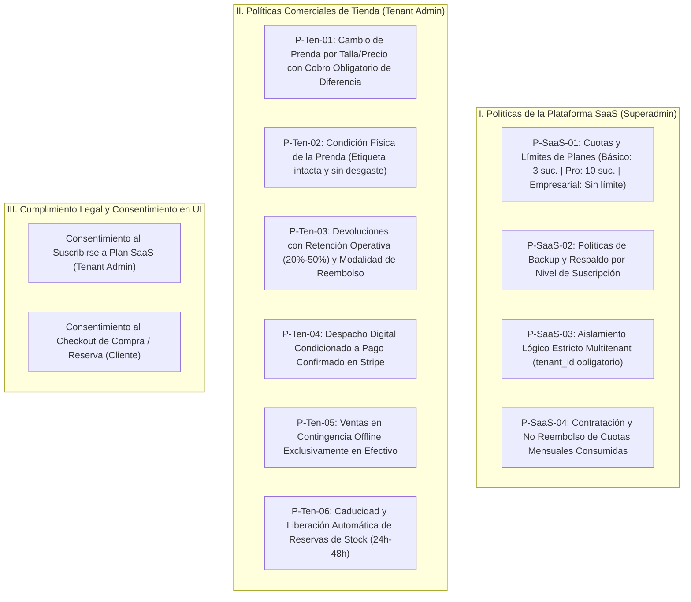

# POLÍTICAS DE NEGOCIO Y REGLAS DE DOMINIO INVIOLABLES
### FashionStore — Plataforma SaaS Multitenant E-Commerce
**Materia:** Sistemas de Información 2 (2do Parcial)  
**Normativa:** Pliego Oficial de Requisitos, Metodología ICONIX y Directrices de Cátedra  
**Alcance:** 25 Casos de Uso Definitivos

---

## 1. Justificación y Propósito

En la comercialización de moda, calzado y confección textil bajo un modelo SaaS multitenant, la rentabilidad, la integridad transaccional y la confianza del cliente dependen del cumplimiento incondicional de las reglas comerciales. Este documento codifica formalmente:
1. **Políticas Globales de la Plataforma SaaS (Gobernanza del Superadmin).**
2. **Políticas Comerciales de los Tenants (Personalizables por Boutique Elegance y Moda Urbana).**
3. **Mecanismos de Consentimiento Explícito de Términos y Condiciones en Frontend.**

---

## 2. Mapa General de Políticas de Negocio

---

## 3. Políticas Globales de la Plataforma SaaS (Superadmin)

### POLÍTICA P-SaaS-01: Niveles de Suscripción y Cuotas Comerciales (CU02 / CU04)
El Superadmin gobierna la plataforma SaaS ofreciendo 3 planes oficiales configurables:

| Característica / Beneficio | Plan BÁSICO | Plan PROFESIONAL | Plan EMPRESARIAL |
| :--- | :---: | :---: | :---: |
| **Sucursales Físicas Activas** | **Hasta 3 sucursales** | **Hasta 10 sucursales** | **Ilimitadas (o hasta 25)** |
| **Catálogo de Prendas y Tallas** | Ilimitado | Ilimitado | Ilimitado |
| **PWA y Operaciones Offline** | Sí (IDB / SQLite) | Sí (IDB / SQLite) | Sí (IDB / SQLite) |
| **Pasarela de Pagos Stripe** | Sí | Sí | Sí |
| **Reportes Convencionales** | Sí | Sí | Sí |
| **IA Generativa con Voz (Gemini)** | ❌ No disponible | ✅ Acceso Completo | ✅ Acceso Completo + Prioritario |
| **Modelos Machine Learning** | ❌ No disponible | ✅ Supervisado / K-Means | ✅ Supervisado / K-Means + AutoML |
| **Política de Backup** | Semanal Local | Diario en la Nube | Tiempo Real con Replicación |
| **Precio Mensual de Referencia** | $29.00 USD / mes | $99.00 USD / mes | $199.00 USD / mes |

* **Regla Inviolable de Creación de Sucursal (`POST /api/branches`):**
  Si el número de sucursales activas alcanza la cuota del plan contratado (ej. 3 de 3 en Básico), el backend bloquea con `HTTP 403 Forbidden` cualquier intento de creación o reactivación hasta solicitar el ascenso de plan.

---

### POLÍTICA P-SaaS-02: Políticas de Backup y Recuperación por Suscripción
Para garantizar la continuidad operativa de cada boutique:
* **Plan Básico:** Exportación semanal manual de balance y catálogo en JSON descargable.
* **Plan Profesional:** Respaldo automatizado diario ejecutado a medianoche en almacenamiento seguro central.
* **Plan Empresarial:** Respaldo incremental continuo con replicación multi-región y restauración instantánea ante contingencias.

---

### POLÍTICA P-SaaS-03: Aislamiento Lógico Multitenant Inquebrantable
* Toda tabla de empresa contiene la clave foránea `tenant_id UUID NOT NULL REFERENCES companies(id)`.
* Ninguna consulta SQL o endpoint REST puede retornar información de un `tenant_id` diferente al token JWT validado en la cabecera `Authorization: Bearer <token>`.

---

## 4. Políticas Comerciales de las Tiendas Tenants (Boutiques)

Cada empresa tenant define sus parámetros comerciales dentro de los límites legales establecidos por la plataforma:

### Tabla Comparativa de Políticas para Tenants de Prueba:

| Parámetro Comercial | Boutique Elegance | Moda Urbana |
| :--- | :--- | :--- |
| **Plazo Máximo para Cambios** | 15 días calendario tras la compra | 30 días calendario tras la compra |
| **Plazo Máximo para Devoluciones**| 7 días calendario tras la compra | 15 días calendario tras la compra |
| **Tasa de Retención Operativa ($R$)**| **30%** (Reembolso neto: 70%) | **20%** (Reembolso neto: 80%) |
| **Modalidad de Reembolso Preferida**| **Nota de Crédito Digital** (Cupón) | **Efectivo** o **Nota de Crédito** |
| **Condición de Etiqueta Textil** | Obligatoria e intacta sin excepción | Obligatoria o comprobante de compra |
| **Horario de Atención de Caja** | Lunes a Sábado: 09:00 - 20:00 | Lunes a Domingo: 10:00 - 21:00 |

---

### POLÍTICA P-Ten-01: Cambio de Prenda por Talla y Cobro de Diferencia (CU17)

#### Declaración de la Regla:
> *Al cambiar una prenda por otra talla o modelo de mayor precio, el cambio se consolida **ÚNICA Y EXCLUSIVAMENTE CUANDO EL CLIENTE ABONA LA DIFERENCIA DE PRECIO**. Si el cliente no abona dicha diferencia, la transacción queda cancelada en el acto, devolviendo la prenda original al cliente y dejando el stock intacto.*

#### Lógica Matemática:
$$\Delta = \text{Precio Prenda Nueva} - \text{Precio Prenda Original}$$
* **Caso $\Delta > 0$ (Prenda nueva más cara):**
  - Ejemplo: Vestido M (Bs 50) cambiado por Vestido L (Bs 70) $\rightarrow \Delta = \text{Bs } 20.00$.
  - Si abona Bs 20 en caja $\rightarrow$ **Aprobado:** Reingresa talla M, egresa talla L, comprobante emitido.
  - Si no abona Bs 20 $\rightarrow$ **Rechazado:** La operación se aborta por el controlador.
* **Caso $\Delta \le 0$ (Prenda nueva de igual o menor precio):**
  - Si $\Delta = 0$ (misma prenda, diferente color) $\rightarrow$ Cambio directo sin costo.
  - Si $\Delta < 0$ (prenda nueva más económica) $\rightarrow$ Se entrega la nueva prenda y la diferencia a favor del cliente se emite en una **Nota de Crédito Digital**.

---

### POLÍTICA P-Ten-02: Inspección Física del Estado de la Prenda
Previo a cualquier cambio o devolución, el personal de caja o encargado ejecuta una inspección física obligatoria:
* **Criterios de Rechazo Inmediato:**
  1. Prenda con signos evidentes de uso prolongado, lavado, desgarro o manchas.
  2. Ausencia de la etiqueta original colgante o cosida de la boutique.
  3. Prenda adquirida en venta final de liquidación ("Sale / Sin cambio").
* **Efecto en el Software:** El cajero marca la casilla *"Prenda no apta para reingreso"* y el controlador rechaza la solicitud emitiendo el comprobante de inspección no conforme.

---

### POLÍTICA P-Ten-03: Devoluciones de Mercadería y Emisión de Notas de Crédito (CU18)

#### ¿Qué es una Nota de Crédito Digital (Modalidad B)?:
> *Una **Nota de Crédito Digital** es un cupón o vale comercial oficial emitido por el sistema a favor del cliente con un código alfanumérico único (`NC-YYYYMMDD-XXXX`), equivalente al monto del reembolso neto aprobado. Este saldo a favor puede ser utilizado por el cliente como medio de pago total o parcial en sus compras futuras dentro de la misma empresa tenant.*

#### Ventajas para la Boutique:
1. **Protección de Liquidez:** La tienda no retira efectivo físico del arqueo de caja de la jornada.
2. **Retención de Cartera:** Asegura que el cliente reinvierta el valor reembolsado en el catálogo de la boutique.
3. **Trazabilidad Contable:** Se descuenta formalmente de las cuentas por cobrar y se registra en auditoría.

#### Fórmulas de Reembolso:
$$\text{Monto Retención} = P_{\text{abonado}} \times \left(\frac{R}{100}\right)$$
$$\text{Monto Reembolso Neto} = P_{\text{abonado}} - \text{Monto Retención}$$

* **Ejemplo Boutique Elegance ($R = 30\%$):**
  - Precio pagado: Bs 100.00.
  - Retención operativa (desinfección y reacondicionamiento): Bs 30.00.
  - Reembolso entregado: Bs 70.00 emitido en **Nota de Crédito Digital** con vigencia de 90 días.

---

### POLÍTICA P-Ten-04: Despacho Digital Condicionado a Pago Confirmado (CU09)
> *El envío o preparación de pedidos digitales se ejecuta **ÚNICAMENTE CUANDO STRIPE CONFIRMA EL PAGO** (`payment_status = 'paid'`). Ninguna orden en estado 'pendiente' puede generar orden de despacho logístico.*

---

### POLÍTICA P-Ten-05: Ventas en Modo Desconectado Exclusivas en Efectivo (CU13)
> *Durante caídas de red o trabajo offline, la única forma de pago autorizada es **EFECTIVO (Contado)**. Se genera un identificador `operation_uuid` (UUIDv4) y se asienta localmente con estado `PENDIENTE_SYNC`.*

---

### POLÍTICA P-Ten-06: Caducidad y Liberación de Reservas de Stock (CU10 / CU12)
> *Toda reserva online u offline bloquea stock por un plazo máximo de **24 a 48 horas**. Cumplido el plazo sin que el cliente consolide la compra en sucursal, el proceso de background libera las existencias automáticamente al stock general.*

---

## 5. Mecanismos de Consentimiento Explícito en Frontend (Términos y Condiciones)

Para garantizar la validez legal y el conocimiento previo de los clientes y tenants:

### A. Al Registrar o Contratar un Plan SaaS (Portal Superadmin / Registro Tenant):
El formulario de alta exige un checkbox bloqueante:
> ☑️ *“He leído y acepto los Términos del Servicio SaaS, los límites de sucursales según el plan contratado y la política de aislamiento y seguridad de datos de FashionStore.”*

### B. En el Checkout de Compra o Reserva Digital (Tienda Online Cliente):
El carrito digital exige antes del botón de pago/reserva:
> ☑️ *“Acepto las Políticas de Cambio (con cobro de diferencia de talla), Devolución (con retención operativa hasta el 30%) y Despacho Condicionado a Pago de [Nombre del Tenant].”*
> *[Enlace interactivo a modal con el texto completo de las políticas].*
