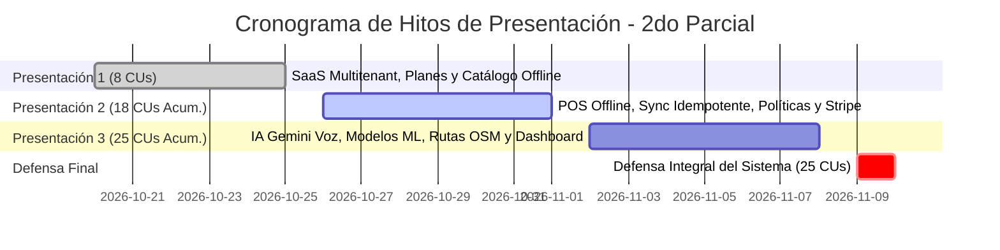

# CRONOGRAMA DE ENTREGAS Y HOJA DE RUTA DE PRESENTACIONES
### FashionStore — Plataforma SaaS Multitenant E-Commerce
**Materia:** Sistemas de Información 2 (2do Parcial)  
**Modalidad de Presentación:** Entregas Incrementales Acumulativas (Sin Ciclos RUP)  
**Total de Casos de Uso:** 25 Casos de Uso Oficiales

---

## 1. Directriz Metodológica de Cátedra

Por disposición de la docente de la asignatura:
> *“El informe final y las defensas se estructuran **sin iteraciones ni ciclos RUP**. El equipo presenta los Casos de Uso trabajados y los incrementa acumulativamente en cada hito de revisión, demostrando el software funcionando de extremo a extremo.”*

Cada presentación suma nuevas funcionalidades sobre la base anterior, garantizando que el sistema crezca de forma estable y verificable.

---

## 2. Cronograma Oficial de Hitos y Casos de Uso

---

### HITO 1: Presentación 1 (25 de Octubre de 2026) — 100% COMPLETADO
**Meta:** Establecer la infraestructura SaaS multitienda, control de cuotas por plan y catálogo de prendas con variantes de talla/precio y almacenamiento desconectado inicial.  
**Alcance Acumulado:** 8 Casos de Uso (`CU01` al `CU08`).

| Código | Caso de Uso | Paquete | Plataforma | Criterio de Aceptación / Verificación |
| :---: | :--- | :---: | :---: | :--- |
| **CU01** | Registrar y Gestionar Empresas (Tenants) | `p0` | Web | Creación de tenant con `subdomain` único y aislamiento multitenant estricto. |
| **CU02** | Gestionar Planes de Suscripción (Básico, Pro, Empresarial) y Cuotas | `p0` | Web | Catálogo de planes: Básico (máx. 3 sucursales), Profesional (máx. 10) y Empresarial (máx. 25). |
| **CU03** | Iniciar Sesión Multitenant con JWT | `p1` | Web / Móvil | Autenticación con inyección de claims `tenant_id`, `rol` y `branch_id`. |
| **CU04** | Gestionar Sucursales Bajo Límites del Plan | `p1` | Web | Bloqueo estricto del backend si se sobrepasa el cupo contratado del plan. |
| **CU05** | Gestionar Prendas y Variantes de Precio por Talla | `p2` | Web | Precios diferenciados por talla para habilitar políticas de cambio. |
| **CU06** | Consultar Catálogo Online con Búsqueda Facetada | `p2` | Web / Móvil | Filtros en vivo por categoría, rango de precios y tallas. |
| **CU07** | Sincronizar y Descargar Catálogo Local (PWA/SQLite)| `p3` | PWA / Móvil | Descarga y persistencia local del catálogo para consulta sin conexión. |
| **CU08** | Consultar Catálogo Offline en Modo Desconectado | `p3` | PWA / Móvil | Navegación íntegra por prendas y tallas en modo desconectado. |

---

### HITO 2: Presentación 2 (01 de Noviembre de 2026) — EN CURSO
**Meta:** Implementar el motor comercial completo: ventas online con Stripe y despacho condicionado, reservas físicas con caducidad, terminal POS offline con sincronización idempotente (`sync_operations`) y políticas inviolables de cambio y devolución.  
**Alcance Acumulado:** 18 Casos de Uso (8 anteriores + 10 nuevos = `CU01` al `CU18`).

| Código | Caso de Uso | Paquete | Plataforma | Criterio de Aceptación / Verificación |
| :---: | :--- | :---: | :---: | :--- |
| **CU09** | Comprar Prendas con Stripe y Despacho Condicionado | `p4` | Web / Móvil | Despacho condicionado: bloqueo estricto si `payment_status != 'paid'`. |
| **CU10** | Crear Reserva Online de Prendas con Vencimiento | `p4` | Web / Móvil | Apartado de stock temporal (máx 7 días) con vencimiento a 24 horas post-visita. |
| **CU11** | Registrar Reserva Offline en Modo Desconectado | `p4` | PWA / Móvil | Registro de apartados sin conexión con UUIDv4 local y outbox. |
| **CU12** | Atender y Resolver Conflictos de Reservas Expiradas | `p4` | Web / Backend | Liberación automática de stock caducado y reasignación de reservas. |
| **CU13** | Registrar Venta POS Desconectada en Efectivo UUIDv4 | `p5` | PWA / Móvil POS | Venta desconectada **exclusivamente en efectivo**, con UUIDv4 local. |
| **CU14** | Gestionar Bandeja Local de Operaciones (Outbox) | `p5` | PWA / Móvil POS | Monitor de operaciones con contador visual y estados de sincronización. |
| **CU15** | Sincronizar Lotes de Ventas con Idempotencia Central | `p5` | Background / API | Endpoint `/api/sales/offline/batch-sync` auditado en `sync_operations` (cero duplicados). |
| **CU16** | Resolver Conflictos de Ventas Offline y Quiebres | `p5` | Web / POS | Tratamiento de sobreventas ocurridas durante la desconexión. |
| **CU17** | Procesar Cambio de Prenda por Talla y Cobro de Diferencia | `p5` | Web / POS | Cobro obligatorio de diferencia ($\Delta$); prenda rechazada si no tiene etiqueta. |
| **CU18** | Procesar Devolución con Retención (20%-50%) y Nota de Crédito | `p5` | Web / POS | Retención operativa y liquidación del saldo neto en efectivo o Nota de Crédito Digital. |

---

### HITO 3: Presentación 3 (08 de Noviembre de 2026) — PROGRAMADO
**Meta:** Incorporar la capa de Inteligencia Artificial, Servicios Geoespaciales y Analítica Predictiva: localización y rutas con OpenStreetMap/ORS, consultas ejecutivas por voz con Gemini API (RAG), exportación formal a PDF/Excel, dataset sintético textil, modelo supervisado de demanda, clustering no supervisado K-Means y dashboard ejecutivo con KPIs.  
**Alcance Acumulado:** 25 Casos de Uso Completos (18 anteriores + 7 nuevos = `CU01` al `CU25`).

| Código | Caso de Uso | Paquete | Plataforma | Criterio de Aceptación / Verificación |
| :---: | :--- | :---: | :---: | :--- |
| **CU19** | Localizar Sucursales y Trazar Rutas (OSM / ORS) | `p6` | Móvil Flutter | Mapa vectorial libre en Flutter con trazado de rutas óptimas con OpenRouteService. |
| **CU20** | Generar Reportes Ejecutivos por Voz (Gemini RAG) | `p6` | Web / Móvil | Consulta RAG a Gemini con entrada/salida de voz y contexto seguro del tenant. |
| **CU21** | Exportar Reportes Empresariales a PDF y Excel | `p6` | Web | Generación de balances dinámicos consolidados de facturación y stock. |
| **CU22** | Generar Dataset Sintético de Ventas y Estacionalidad | `p6` | Backend Script | Generador estocástico de 10,000+ registros con estacionalidad de moda textil. |
| **CU23** | Predecir Demanda de Ropa (ML Supervisado) | `p6` | Web / Backend | Regresión RandomForest para proyectar demanda por talla y categoría ($R^2 \ge 0.80$). |
| **CU24** | Segmentar Clientes con K-Means (ML No Supervisado) | `p6` | Web / Backend | Clustering K-Means con 4 clusters basados en RFM y devoluciones. |
| **CU25** | Visualizar Dashboard Ejecutivo con KPIs y ML | `p6` | Web | Tablero interactivo con métricas en tiempo real e inferencias analíticas. |

---

### HITO 4: Defensa Final Oficial (10 de Noviembre de 2026)
**Meta:** Defensa integral y rigurosa ante el tribunal docente de la plataforma FashionStore.
- Demostración en vivo de los **25 Casos de Uso**.
- Presentación del informe formal bajo metodología **ICONIX** (Fichas de CU, Diagramas de Robustez con loops en Controlador, Diagramas de Secuencia y Clases).
- Verificación en vivo de resiliencia: corte de Internet en terminal POS, venta offline en efectivo, reconexión de red y sincronización idempotente sin transacciones duplicadas.
