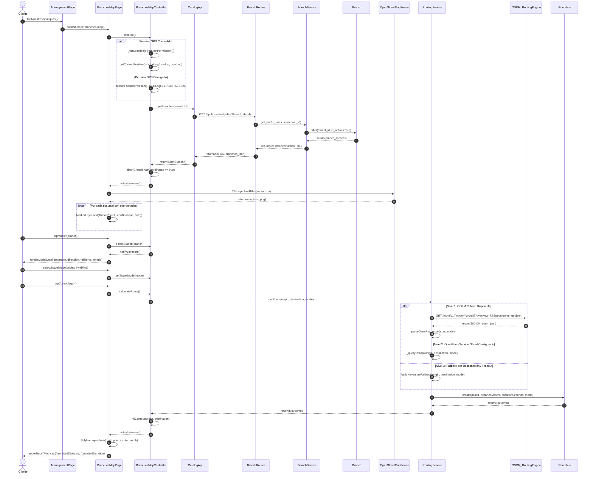
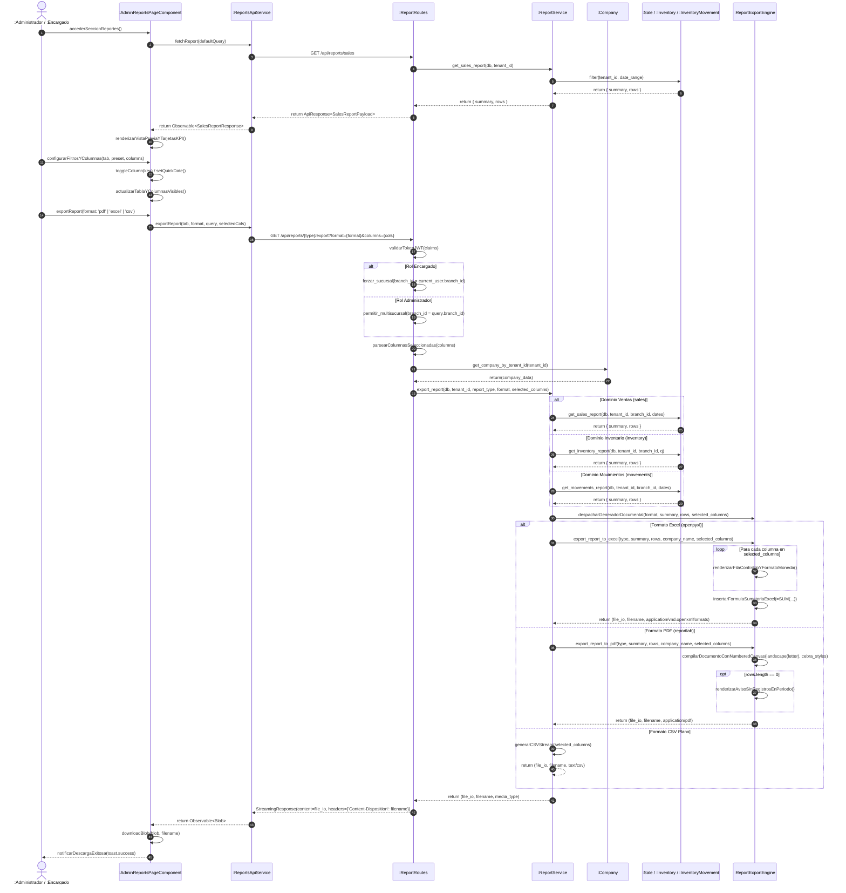
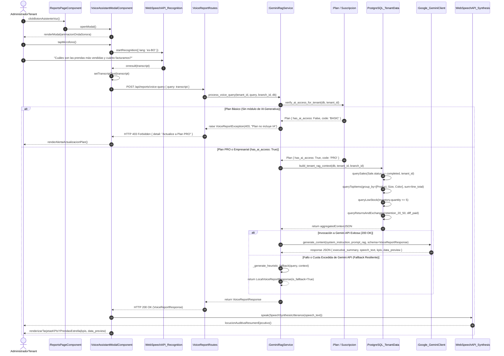
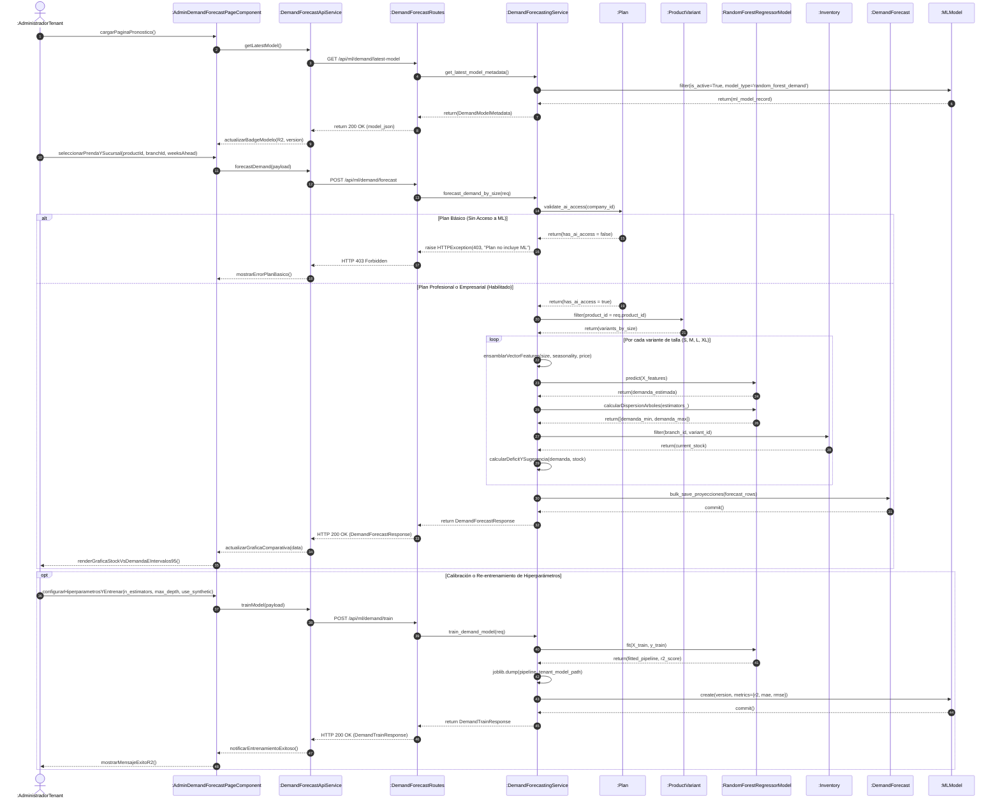

# GUÍA DE DIAGRAMAS DE SECUENCIA Y MAPEO AL CÓDIGO FUENTE
### FashionStore — Plataforma E-Commerce SaaS Multitenant (Sistemas 2)
**Metodología:** ICONIX Process (UML 2.5+)  
**Directorio de Modelos:** `docsUML/CUSecuencia/` y `docsUML/CUrobustez/`  

Este documento centraliza la especificación técnica, el mapeo de componentes BCE contra el código fuente implementado y la previsualización interactiva en Mermaid para cada uno de los diagramas de secuencia del sistema.

---

## Índice de Casos de Uso Documentados
1. [CU19: Localizar Sucursales y Trazar Rutas (OpenStreetMap / ORS en Flutter)](#cu19-localizar-sucursales-y-trazar-rutas-openstreetmap--ors)
2. [CU20: Generar Reportes Ejecutivos por Voz y Lenguaje Natural (Gemini RAG)](#cu20-generar-reportes-ejecutivos-por-voz-y-lenguaje-natural-gemini-rag)
3. [CU21: Exportar Reportes Empresariales a Formatos PDF y Excel](#cu21-exportar-reportes-empresariales-a-formatos-pdf-y-excel)
4. [CU23: Predecir Demanda de Ropa por Talla (ML Supervisado - RandomForest)](#cu23-predecir-demanda-de-ropa-por-talla-ml-supervisado---randomforest)

---

## CU19: Localizar Sucursales y Trazar Rutas (OpenStreetMap / ORS)

### 1. Ficha Técnica y Scripts Enterprise Architect
- **Script Secuencia (JScript):** [`docsUML/CUSecuencia/CU19_secuencia_localizar_sucursales_rutas_EA.js`](file:///c:/Users/PERSONAL/ecommerce-SI2/docsUML/CUSecuencia/CU19_secuencia_localizar_sucursales_rutas_EA.js)
- **Script Robustez / Comunicación (JScript):** [`docsUML/CUrobustez/CU19_comm_localizar_sucursales_rutas_EA.js`](file:///c:/Users/PERSONAL/ecommerce-SI2/docsUML/CUrobustez/CU19_comm_localizar_sucursales_rutas_EA.js)
- **Alcance Arquitectónico:** Frontend Móvil Flutter (`mobile/`) + Backend FastAPI (`p1_gestion_usuarios_acceso`).

### 2. Tabla Comparativa: Componentes ICONIX vs Flujo del Código Fuente

| Rol BCE | Componente en Diagrama UML | Elemento en Código Fuente | Métodos / Operaciones Invocadas | Responsabilidad en el Flujo |
| :--- | :--- | :--- | :--- | :--- |
| **Actor** | `Cliente` | Usuario Móvil / `Customer` | Interacción táctil en pantalla | Inicia la navegación, concede permisos de GPS, selecciona boutique y escoge modo de viaje. |
| **Boundary** | `:ManagementPage` | [`management_page.dart`](file:///c:/Users/PERSONAL/ecommerce-SI2/mobile/lib/features/management/management_page.dart) | `Navigator.pushNamed(AppRoutes.branchesMap)` | Portal de gestión y boutiques donde se ubica la tarjeta de acceso a "Nuestras boutiques". |
| **Boundary** | `:BranchesMapPage` | [`branches_map_page.dart`](file:///c:/Users/PERSONAL/ecommerce-SI2/mobile/lib/features/branches_map/branches_map_page.dart) | `initState()`, `_buildFloatingModeSelector()`, `_buildBranchDetailsCard()` | Renderiza el widget `FlutterMap` con `TileLayer`, `MarkerLayer`, `PolylineLayer`, selector y tarjeta de boutique. |
| **Controller** | `:BranchesMapController` | [`branches_map_controller.dart`](file:///c:/Users/PERSONAL/ecommerce-SI2/mobile/lib/features/branches_map/branches_map_controller.dart) | `initialize()`, `_initLocation()`, `selectBranch()`, `setTravelMode()`, `calculateRoute()` | Coordina reactivamente la obtención del GPS, filtrado de sucursales activas, selección y solicitud de ruta. |
| **Controller** | `:CatalogApi` | [`catalog_api.dart`](file:///c:/Users/PERSONAL/ecommerce-SI2/mobile/lib/features/catalog/catalog_api.dart) | `getBranches({tenantId})` | Cliente HTTP móvil en Flutter que despacha la petición al backend central. |
| **Controller** | `:BranchRoutes` | [`branch_routes.py`](file:///c:/Users/PERSONAL/ecommerce-SI2/backend/app/packages/p1_gestion_usuarios_acceso/routes/branch_routes.py) | `@router.get("/public")` | Endpoint REST público en FastAPI con inyección y validación de `tenant_id`. |
| **Controller** | `:BranchService` | [`branch_service.py`](file:///c:/Users/PERSONAL/ecommerce-SI2/backend/app/packages/p1_gestion_usuarios_acceso/services/branch_service.py) | `get_public_branches(db, tenant_id)` | Controlador de dominio backend que consulta y serializa las sucursales con coordenadas. |
| **Boundary (Ext)** | `:OpenStreetMapServer` | Servidor CDN OpenStreetMap | `TileLayer(urlTemplate: "https://tile.openstreetmap.org/...")` | Suministra dinámicamente las teselas raster cartográficas según coordenadas y nivel de zoom. |
| **Boundary (Ext)** | `:OSRM_RoutingEngine` | API Pública OSRM / OpenRouteService | `GET /route/v1/{mode}/{coords}?overview=full&geometries=geojson` | Calcula la geometría vial real de la ruta, distancia total en metros y duración en segundos. |
| **Controller** | `:RoutingService` | [`routing_service.dart`](file:///c:/Users/PERSONAL/ecommerce-SI2/mobile/lib/features/branches_map/routing_service.dart) | `getRoute()`, `_parseOsrmResponse()`, `_buildHaversineFallback()` | Motor híbrido de 3 niveles: OSRM público sin API Key, ORS oficial inyectable y fallback geodésico Haversine. |
| **Entity** | `:Branch` | [`catalog_models.dart`](file:///c:/Users/PERSONAL/ecommerce-SI2/mobile/lib/features/catalog/catalog_models.dart) / [`branch_model.py`](file:///c:/Users/PERSONAL/ecommerce-SI2/backend/app/packages/p1_gestion_usuarios_acceso/models/branch_model.py) | `hasCoordinates`, `latitude`, `longitude`, `address`, `phone` | Representa la sucursal física en base de datos PostgreSQL y en la memoria móvil. |
| **Entity** | `:RouteInfo` | [`routing_models.dart`](file:///c:/Users/PERSONAL/ecommerce-SI2/mobile/lib/features/branches_map/routing_models.dart) | `formattedDistance`, `formattedDuration`, `points` | Objeto de valor móvil que encapsula la polilínea decodificada y las métricas formateadas. |

### 3. Previsualización del Diagrama de Secuencia (Mermaid UML)

---

## CU21: Exportar Reportes Empresariales a Formatos PDF y Excel

### 1. Ficha Técnica y Scripts Enterprise Architect
- **Script Secuencia (JScript):** [`docsUML/CUSecuencia/CU21_secuencia_exportacion_reportes_EA.js`](file:///c:/Users/PERSONAL/ecommerce-SI2/docsUML/CUSecuencia/CU21_secuencia_exportacion_reportes_EA.js)
- **Script Robustez / Comunicación (JScript):** [`docsUML/CUrobustez/CU21_comm_exportacion_reportes_EA.js`](file:///c:/Users/PERSONAL/ecommerce-SI2/docsUML/CUrobustez/CU21_comm_exportacion_reportes_EA.js)
- **Alcance Arquitectónico:** Frontend Web Angular 21 PWA (`frontend/`) + Backend FastAPI (`p6_inteligencia_analitica`).

### 2. Tabla Comparativa: Componentes ICONIX vs Flujo del Código Fuente

| Capa / Etapa | Componente / Archivo Físico | Función / Endpoint Implementado | Responsabilidad Técnica |
| :--- | :--- | :--- | :--- |
| **Actor** | `Administrador` / `Encargado` | Navegador Web / PWA | Parametriza filtros, selecciona columnas y pulsa exportar. |
| **Boundary (UI)** | [`admin-reports-page.component.ts`](file:///c:/Users/PERSONAL/ecommerce-SI2/frontend/src/app/features/admin/pages/admin-reports-page.component.ts) | `setTab()`, `toggleColumn()`, `setQuickDate()`, `exportReport(format)` | Gestión reactiva de estado, panel colapsable de columnas y visualización en tabla. |
| **Boundary (API)**| [`reports-api.service.ts`](file:///c:/Users/PERSONAL/ecommerce-SI2/frontend/src/app/features/shared/services/reports-api.service.ts) | `exportReport(type, format, query, columns)` / `downloadBlob()` | Inyección de query params (`columns`), petición HTTP con `responseType: 'blob'` y trigger de descarga `<a>`. |
| **Router REST** | [`report_routes.py`](file:///c:/Users/PERSONAL/ecommerce-SI2/backend/app/packages/p6_inteligencia_analitica/routes/report_routes.py) | `GET /api/reports/{report_type}/export` `GET /api/reports/export/excel` `GET /api/reports/export/pdf` | Autenticación JWT, control de rol (fuerza `branch_id` para `encargado`), parseo de `columns` y streaming binario. |
| **Controller Dominio** | [`report_service.py`](file:///c:/Users/PERSONAL/ecommerce-SI2/backend/app/packages/p6_inteligencia_analitica/services/report_service.py) | `export_report(db, tenant_id, report_type, format, selected_columns, ...)` | Orquestación de consultas analíticas y bifurcación hacia el motor ofimático correspondiente. |
| **Consultas SQL** | [`report_service.py`](file:///c:/Users/PERSONAL/ecommerce-SI2/backend/app/packages/p6_inteligencia_analitica/services/report_service.py) | `get_sales_report()` `get_inventory_report()` `get_movements_report()` | Agregaciones SQL agrupadas por sucursal, producto y variante con filtros temporales. |
| **Motor Excel** | [`report_service.py`](file:///c:/Users/PERSONAL/ecommerce-SI2/backend/app/packages/p6_inteligencia_analitica/services/report_service.py) | `export_report_to_excel(...)` con `openpyxl` | Generación de libro `.xlsx`, membrete corporativo, estilos de celda, proyección de columnas y fórmulas vivas `=SUM(...)`. |
| **Motor PDF** | [`report_service.py`](file:///c:/Users/PERSONAL/ecommerce-SI2/backend/app/packages/p6_inteligencia_analitica/services/report_service.py) | `export_report_to_pdf(...)` con `reportlab` | Documento apaisado `landscape(letter)`, `NumberedCanvas` (*"Página X de Y"*), tarjetas KPI y tablas cebra. |
| **Entidades BD** | `Sale`, `SaleItem`, `Inventory`, `InventoryMovement`, `Company` | Tablas en PostgreSQL 15+ | Entidades de dominio particionadas bajo estricto aislamiento por `tenant_id`. |
| **Respuesta HTTP**| `StreamingResponse` (FastAPI / Starlette) | `Content-Type: application/pdf` `application/vnd.openxmlformats...` | Streaming binario en memoria vía `io.BytesIO` sin almacenamiento temporal en disco. |

### 3. Previsualización del Diagrama de Secuencia (Mermaid UML)

---

## CU20: Generar Reportes Ejecutivos por Voz y Lenguaje Natural (Gemini RAG)

### 1. Ficha Técnica y Scripts Enterprise Architect
- **Script Secuencia (JScript):** [`docsUML/CUSecuencia/CU20_secuencia_reportes_voz_gemini_EA.js`](file:///c:/Users/PERSONAL/ecommerce-SI2/docsUML/CUSecuencia/CU20_secuencia_reportes_voz_gemini_EA.js)
- **Script Robustez / Comunicación (JScript):** [`docsUML/CUrobustez/CU20_comm_reportes_voz_gemini_EA.js`](file:///c:/Users/PERSONAL/ecommerce-SI2/docsUML/CUrobustez/CU20_comm_reportes_voz_gemini_EA.js)
- **Alcance Arquitectónico:** Frontend Web Angular PWA (`frontend/src/app/`) + Backend FastAPI (`p6_inteligencia_analitica`) + Google Gemini 2.5 Flash + Web Speech API.

### 2. Tabla Comparativa: Componentes ICONIX vs Flujo del Código Fuente

| Rol BCE | Componente en Diagrama UML | Elemento en Código Fuente | Métodos / Operaciones Invocadas | Responsabilidad en el Flujo |
| :--- | :--- | :--- | :--- | :--- |
| **Actor** | `:AdministradorTenant` | Usuario Administrador de Boutique | `clickBotonAsistenteVoz()`, `dictarConsultaVoz()` | Inicia la consulta ejecutiva mediante dictado por voz o texto natural en la PWA. |
| **Boundary** | `:ReportsPageComponent` | [`admin-reports-page.component.ts`](file:///c:/Users/PERSONAL/ecommerce-SI2/frontend/src/app/features/admin/pages/admin-reports-page.component.ts) | `openVoiceAssistant()`, `closeVoiceAssistant()` | Contenedor principal de reportes que aloja el botón de activación del asistente. |
| **Boundary** | `:VoiceAssistantModalComponent` | [`voice-assistant-modal.component.ts`](file:///c:/Users/PERSONAL/ecommerce-SI2/frontend/src/app/features/admin/components/voice-assistant-modal.component.ts) | `startListening()`, `submitQuery()`, `toggleSpeech()`, `resetConversation()` | Interfaz modal con espectrograma animado de audio, transcripción reactiva, chips y visualización de KPIs. |
| **Boundary (Nativo)** | `:WebSpeechAPI_Recognition` | `window.webkitSpeechRecognition` | `recognition.start()`, `recognition.onresult`, `recognition.onend` | Captura el stream de audio del micrófono y realiza transcripción a texto en tiempo real (`lang: 'es-BO'`). |
| **Boundary (Nativo)** | `:WebSpeechAPI_Synthesis` | `window.speechSynthesis` | `speechSynthesis.speak(utterance)`, `speechSynthesis.cancel()` | Reproduce auditivamente la locución sintetizada del resumen ejecutivo devuelto por el RAG. |
| **Controller** | `:VoiceReportRoutes` | [`voice_report_routes.py`](file:///c:/Users/PERSONAL/ecommerce-SI2/backend/app/packages/p6_inteligencia_analitica/routes/voice_report_routes.py) | `@router.post("/voice-query")` | Endpoint REST autenticado que recibe `VoiceQueryRequest`, extrae `tenant_id` del JWT e inyecta la sesión de BD. |
| **Controller** | `:GeminiRagService` | [`gemini_rag_service.py`](file:///c:/Users/PERSONAL/ecommerce-SI2/backend/app/packages/p6_inteligencia_analitica/services/gemini_rag_service.py) | `process_voice_query()`, `verify_ai_access_for_tenant()`, `build_tenant_rag_context()`, `_generate_heuristic_fallback()` | Controlador de dominio central: valida acceso por plan (CU02/CU04), ensambla contexto PostgreSQL y orquesta Gemini con fallback. |
| **Controller (SDK)** | `:Google_GeminiClient` | `google.genai.Client` (`gemini-2.5-flash`) | `client.models.generate_content(contents, config)` | Invocación remota al LLM con System Prompt analítico estricto y formato de salida JSON estructurado. |
| **Entity** | `:Plan` / `:Subscription` | [`plan.py`](file:///c:/Users/PERSONAL/ecommerce-SI2/backend/app/packages/p0_saas_plataforma/models/plan.py) / [`subscription.py`](file:///c:/Users/PERSONAL/ecommerce-SI2/backend/app/packages/p0_saas_plataforma/models/subscription.py) | `has_ai_access`, `code`, `is_active` | Valida políticas SaaS: Plan Básico deniega acceso (HTTP 403); Planes Pro y Empresarial habilitan IA. |
| **Entity** | `:PostgreSQL_TenantData` | `Sale`, `SaleItem`, `Inventory`, `GarmentReturn`, `GarmentExchange` | `filter(tenant_id=...)`, `Sale.status == completed` | Entidades de base de datos que aportan métricas de ventas, prendas estrella, stock crítico y devoluciones. |
| **Entity** | `:VoiceReportResponse` | [`voice_report_schema.py`](file:///c:/Users/PERSONAL/ecommerce-SI2/backend/app/packages/p6_inteligencia_analitica/schemas/voice_report_schema.py) | `executive_summary`, `speech_text`, `kpis`, `data_preview`, `is_fallback` | DTO tipado y estructurado devuelto al cliente frontend para su presentación visual y auditiva. |

### 3. Previsualización del Diagrama de Secuencia (Mermaid UML)

---

## CU23: Predecir Demanda de Ropa por Talla (ML Supervisado - RandomForest)

### 1. Ficha Técnica y Scripts Enterprise Architect
- **Script Secuencia (JScript):** [`docsUML/CUSecuencia/CU23_secuencia_prediccion_demanda_talla_EA.js`](file:///c:/Users/PERSONAL/ecommerce-SI2/docsUML/CUSecuencia/CU23_secuencia_prediccion_demanda_talla_EA.js)
- **Script Robustez / Comunicación (JScript):** [`docsUML/CUrobustez/CU23_comm_prediccion_demanda_talla_EA.js`](file:///c:/Users/PERSONAL/ecommerce-SI2/docsUML/CUrobustez/CU23_comm_prediccion_demanda_talla_EA.js)
- **Alcance Arquitectónico:** Frontend Web Angular 21 PWA (`features/admin/pages/`) + Backend FastAPI (`p6_inteligencia_analitica`) + Scikit-Learn.

### 2. Tabla Comparativa: Componentes ICONIX vs Flujo del Código Fuente

| Rol BCE | Componente en Diagrama UML | Elemento en Código Fuente | Métodos / Operaciones Invocadas | Responsabilidad en el Flujo |
| :--- | :--- | :--- | :--- | :--- |
| **Actor** | `AdministradorTenant` | Administrador / Gerente de Boutique | Interacción en PWA | Selecciona prenda, sucursal, horizonte temporal (1 a 8 semanas) y solicita pronóstico. |
| **Boundary** | `:AdminDemandForecastPageComponent` | [`admin-demand-forecast-page.component.ts`](file:///c:/Users/PERSONAL/ecommerce-SI2/frontend/src/app/features/admin/pages/admin-demand-forecast-page.component.ts) | `onProductSelect()`, `executeForecast()`, `trainModel()` | Renderiza tarjetas KPI, gráfica de barras proporcional stock vs demanda y tabla con intervalos 95%. |
| **Controller** | `:DemandForecastApiService` | [`demand-forecast-api.service.ts`](file:///c:/Users/PERSONAL/ecommerce-SI2/frontend/src/app/features/shared/services/demand-forecast-api.service.ts) | `forecastDemand()`, `getStockAlerts()`, `trainModel()`, `getLatestModel()` | Cliente HTTP Angular que despacha requests JSON autenticados al backend FastAPI. |
| **Controller** | `:DemandForecastRoutes` | [`demand_forecast_routes.py`](file:///c:/Users/PERSONAL/ecommerce-SI2/backend/app/packages/p6_inteligencia_analitica/routes/demand_forecast_routes.py) | `POST /api/ml/demand/forecast`, `POST /train`, `GET /latest-model` | Router FastAPI con inyección de dependencias `current_company`, `current_branch_id` y `get_db`. |
| **Controller** | `:DemandForecastingService` | [`demand_forecasting_service.py`](file:///c:/Users/PERSONAL/ecommerce-SI2/backend/app/packages/p6_inteligencia_analitica/services/demand_forecasting_service.py) | `forecast_demand_by_size()`, `train_demand_model()`, `get_stock_alerts()` | Servicio de ML que valida acceso IA, extrae features estacionales, invoca el estimador y genera alertas. |
| **Controller** | `:RandomForestRegressorModel` | Pipeline Scikit-Learn (`joblib` `.joblib`) | `predict()`, `estimators_` (dispersión para intervalo de confianza 95%) | Ensamble supervisado de árboles que predice la curva de demanda semanal por talla. |
| **Entity** | `:Plan` / `:Company` | [`company.py`](file:///c:/Users/PERSONAL/ecommerce-SI2/backend/app/packages/p0_saas_plataforma/models/company.py) | `validate_ai_access()`, `has_ai_access` | Entidad de suscripción SaaS que autoriza planes Pro/Empresarial y bloquea Plan Básico (403). |
| **Entity** | `:ProductVariant` | [`product_variant.py`](file:///c:/Users/PERSONAL/ecommerce-SI2/backend/app/packages/p2_gestion_productos_catalogo/models/product_variant.py) | `query(ProductVariant).filter(...)` | Variantes de prenda agrupadas por talla (S, M, L, XL) con sus precios de venta. |
| **Entity** | `:SaleItem` | [`sale_item.py`](file:///c:/Users/PERSONAL/ecommerce-SI2/backend/app/packages/p5_gestion_ventas_pos/models/sale_item.py) | `query(SaleItem).join(Sale)...` | Registro histórico de transacciones textiles utilizado para el entrenamiento del modelo. |
| **Entity** | `:Inventory` | [`inventory.py`](file:///c:/Users/PERSONAL/ecommerce-SI2/backend/app/packages/p3_gestion_inventario_disponibilidad/models/inventory.py) | `query(Inventory).filter(branch_id, variant_id)` | Existencias físicas en percha de la sucursal seleccionada. |
| **Entity** | `:DemandForecast` | [`demand_forecast.py`](file:///c:/Users/PERSONAL/ecommerce-SI2/backend/app/packages/p6_inteligencia_analitica/models/demand_forecast.py) | `commit()`, `bulk_save_objects()` | Persistencia de predicciones, faltantes calculados y sugerencias de compra. |
| **Entity** | `:MLModel` | [`ml_model.py`](file:///c:/Users/PERSONAL/ecommerce-SI2/backend/app/packages/p6_inteligencia_analitica/models/ml_model.py) | `query(MLModel).filter(is_active=True)` | Registro de auditoría con la versión, hiperparámetros y métricas de ajuste ($R^2$, $MAE$, $RMSE$). |

### 3. Previsualización del Diagrama de Secuencia (Mermaid UML)

