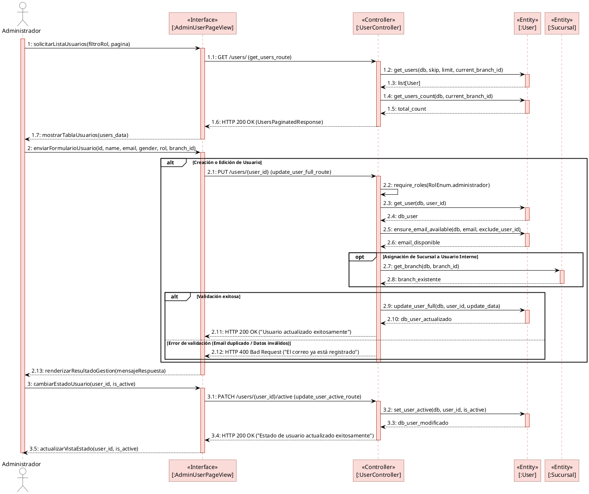
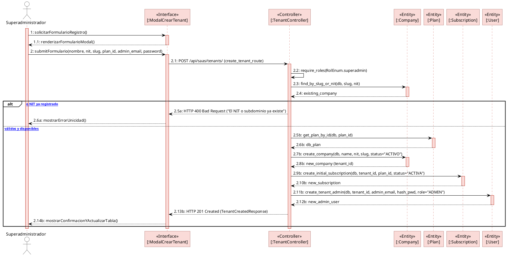
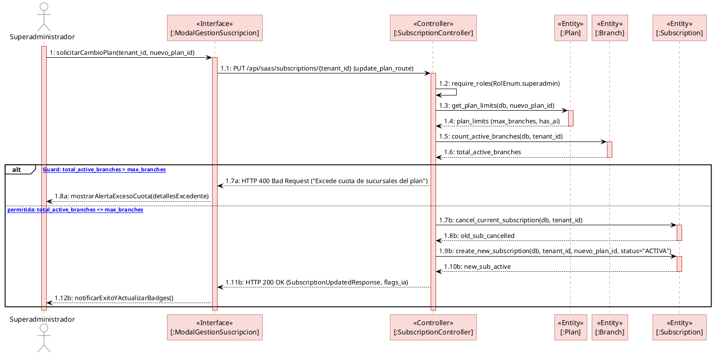

# GUÍA Y ESTÁNDAR OFICIAL: DIAGRAMAS DE SECUENCIA BCE (ICONIX)
### FashionStore SaaS Multitenant — Sistemas 2

Esta guía define las reglas estrictas, la plantilla de estilos, el diseño visual y los ejemplos canónicos para la construcción de **Diagramas de Secuencia Académicos** bajo la arquitectura **BCE (Boundary-Control-Entity)**.

---

## 1. 📐 Reglas y Formato Obligatorio

| Criterio | Especificación Estricta |
| :--- | :--- |
| **Fondo** | Completamente blanco (`#FFFFFF`). |
| **Participantes** | Cajas rectangulares con esquinas limpias. **Color de recuadro: Rosa claro** (`#FADBD8` / `#FCE4EC`). |
| **No usar cilindros** | La base de datos y las tablas relacionales se diagraman **exclusivamente como rectángulos** con el estereotipo `<<Entity>>` (o `<<Database>>` si representa la base física). |
| **Arquitectura BCE** | Distribución horizontal fija: **Actor → Interfaz (Boundary) → Controlador (Control) → Entidades (Entities)**. |
| **Líneas de Vida (Lifelines)** | Trazar barras verticales de activación (color rosa claro) donde inician y terminan los llamados. Se incluye la línea de vida del actor. |
| **Estereotipos Visibles** | Cada participante debe tener su estereotipo explícito y nombre entre corchetes con dos puntos: <br>• `<<Actor>>` `NombreActor`<br>• `<<Interface>>` `[:NombreBoundary]`<br>• `<<Controller>>` `[:NombreController]`<br>• `<<Entity>>` `[:NombreEntity]` |
| **Numeración de Pasos** | Flujo jerárquico decimal obligatorio: `1`, `1.1`, `1.2`, `2`, `2.1`, `2.2`, `3`, etc. |
| **Nivel Técnico** | Los mensajes deben incluir endpoints HTTP reales (`GET /users/`, `POST /api/saas/...`), nombres de métodos del backend (`require_roles()`, `get_user()`), parámetros y tipos de retorno (`list[User]`, `HTTP 200 OK`, `HTTP 400 Bad Request`). |
| **Retornos Controlados** | Las respuestas (flechas discontinuas) **únicamente retornan hacia el Controlador** o **desde la Interfaz hacia el Actor**. |
| **Aislamiento entre Entidades** | **PROHIBIDO:** Las entidades `<<Entity>>` **NUNCA** se envían mensajes entre sí ni retornan datos a otras entidades. Toda la interacción pasa por el `<<Controller>>`. |
| **Centralización en el Controlador** | Toda la lógica de negocio, validaciones, control de transacciones y bifurcaciones residen en el Controlador. |
| **Fragmentos UML** | • `alt`: Para decisiones y bifurcaciones (máximo 2 `alt` por diagrama salvo lógica extremadamente compleja).<br>• `opt`: Para acciones opcionales condicionales.<br>• `loop`: Para iteraciones sobre listas o lotes.<br>• No usar fragmentos innecesarios para evitar sobrecarga visual. |
| **Trazado y Legibilidad** | Mantener el diagrama limpio, académico, sin cruces de líneas y con espaciado vertical armónico. |

---

## 2. 🎨 Plantilla Visual Canónica (PlantUML)

Para obtener exactamente el estilo visual de la referencia académica (fondo blanco, recuadros rosa claro, barras de activación en rosa y tipografía limpia), se utiliza el siguiente bloque de estilos:

```plantuml
@startuml
skinparam backgroundColor #FFFFFF
skinparam shadowing false
skinparam roundcorner 0
skinparam defaultFontName Arial
skinparam defaultFontSize 12

' Estilo de los participantes (Rectángulos en Rosa Claro)
skinparam participant {
    BackgroundColor #FADBD8
    BorderColor #7B241C
    FontColor #000000
    FontStyle bold
}

' Estilo del Actor
skinparam actor {
    BackgroundColor #FFFFFF
    BorderColor #000000
    FontColor #000000
}

' Estilo de las Líneas de Vida (Activaciones en Rosa Claro)
skinparam sequenceLifeLine {
    BorderColor #C0392B
    BackgroundColor #FADBD8
}

' Estilo de las Flechas y Mensajes
skinparam sequenceArrow {
    Color #000000
    FontColor #000000
}

' Estilo de los Fragmentos (alt, opt, loop)
skinparam sequenceGroup {
    BorderColor #000000
    BackgroundColor #FFFFFF
    HeaderFontColor #000000
    HeaderFontStyle bold
}
@enduml
```

---

## 3. 🏆 Diagrama Maestro de Referencia (Gestión de Usuarios)

Diagrama equivalente a la imagen de muestra académica suministrada:



---

## 4. 🛍️ Ejemplo Aplicado al Proyecto: CU01 - Registrar Empresas (Tenants)

Alineado con el backend FastAPI y los modelos SQLAlchemy del proyecto (`p0_saas_plataforma`):



---

## 5. 💳 Ejemplo Aplicado al Proyecto: CU02 - Gestionar Planes y Límites

Demostración del **Downgrade Guard** y actualización de banderas (*feature flags*) de Inteligencia Artificial:



---

## 6. 🛠️ Plantilla Base VBScript para Enterprise Architect (Alineada al Estándar)

Plantilla genérica en VBScript para Enterprise Architect que implementa la estructura BCE (`<<Interface>> [:Boundary]`, `<<Controller>> [:Control]`, `<<Entity>> [:Entity]`), alineación horizontal, numeración jerárquica y manejo de conectores:

```vbscript
option explicit

!INC Local Scripts.EAConstants-VBScript

' ==============================================================================
' Plantilla Base VBScript para Enterprise Architect (ICONIX BCE UML 2.5)
' ==============================================================================

sub OnDiagramScript()
    dim currentPackage
    set currentPackage = Repository.GetTreeSelectedPackage()
    
    if currentPackage is nothing then
        Session.Prompt "Por favor, selecciona un paquete en el Project Browser.", promptOK
        exit sub
    end if

    ' Configuración del Diagrama (Ejemplo)
    crearDiagramaSecuenciaBCE currentPackage, _
        "Nombre del Caso de Uso", "NombreActor", _
        Array( _
            Array("[:NombreBoundary]", "Object", "Interface"), _
            Array("[:NombreController]", "Object", "Controller"), _
            Array("[:NombreEntity1]", "Object", "Entity"), _
            Array("[:NombreEntity2]", "Object", "Entity") _
        ), _
        Array( _
            Array("NombreActor", "[:NombreBoundary]", "1: accionUsuario()", False, "", ""), _
            Array("[:NombreBoundary]", "[:NombreController]", "1.1: METODO /api/endpoint", False, "", ""), _
            Array("[:NombreController]", "[:NombreController]", "1.2: validacionInterna()", True, "", ""), _
            Array("[:NombreController]", "[:NombreEntity1]", "1.3: consultaDatos()", False, "", ""), _
            Array("[:NombreEntity1]", "[:NombreController]", "1.4: datosRetornados", False, "", ""), _
            Array("[:NombreController]", "[:NombreBoundary]", "1.5: HTTP 200 OK (Respuesta)", False, "", ""), _
            Array("[:NombreBoundary]", "NombreActor", "1.6: renderizarResultado()", False, "", "") _
        )

    Session.Prompt "¡Diagrama de Secuencia BCE generado con éxito!", promptOK
end sub

' ------------------------------------------------------------------------------
' Motor Gráfico y Conectores de Secuencia en Enterprise Architect
' ------------------------------------------------------------------------------
sub crearDiagramaSecuenciaBCE(package, nombreDiag, actorName, lifelines, mensajes)
    dim actor
    set actor = crearElem(package, actorName, "Actor", "")

    dim names(), objs()
    dim i, l, n, t, st, ob, cnt
    cnt = 0

    for each l in lifelines
        n = l(0) : t = l(1) : st = l(2)
        set ob = crearElem(package, n, t, st)
        ReDim Preserve names(cnt) : ReDim Preserve objs(cnt)
        names(cnt) = n : set objs(cnt) = ob
        cnt = cnt + 1
    next

    dim diag
    set diag = crearDiagLimpio(package, "Secuencia " & nombreDiag, "Sequence")

    dim x, xStep, yTop, yBottom
    x = 50 : xStep = 180 : yTop = -50 : yBottom = -230

    colocElem diag, actor, x, x + 70, yTop, yBottom
    x = x + xStep

    dim j
    for j = 0 to UBound(objs)
        colocElem diag, objs(j), x, x + 70, yTop, yBottom
        x = x + xStep
    next

    dim m, orig, dest, txt, isSelf, altFrag, cond
    dim origObj, destObj

    for each m in mensajes
        orig = m(0) : dest = m(1) : txt = m(2)
        isSelf = m(3) : altFrag = m(4) : cond = m(5)

        if orig = actorName then
            set origObj = actor
        else
            set origObj = findLifeline(orig, names, objs)
        end if

        if dest = actorName then
            set destObj = actor
        else
            set destObj = findLifeline(dest, names, objs)
        end if

        if not origObj is nothing and not destObj is nothing then
            crearMsgSeq origObj, destObj, txt, altFrag, cond
        end if
    next

    Repository.SaveDiagram diag.DiagramID
    Repository.ReloadDiagram diag.DiagramID
    Repository.OpenDiagram diag.DiagramID
end sub

function findLifeline(n, names, objs)
    dim i
    for i = 0 to UBound(names)
        if names(i) = n then
            set findLifeline = objs(i)
            exit function
        end if
    next
    set findLifeline = nothing
end function

function crearElem(pkg, name, tipo, st)
    dim el
    for each el in pkg.Elements
        if el.Name = name and el.Type = tipo then
            if st <> "" and el.Stereotype <> st then
                el.Stereotype = st
                el.Update()
            end if
            set crearElem = el
            exit function
        end if
    next
    set el = pkg.Elements.AddNew(name, tipo)
    if st <> "" then el.Stereotype = st
    el.Update()
    pkg.Elements.Refresh()
    set crearElem = el
end function

function crearDiagLimpio(pkg, name, tipo)
    dim d, i
    for each d in pkg.Diagrams
        if d.Name = name then
            for i = d.DiagramObjects.Count - 1 to 0 step -1
                d.DiagramObjects.Delete i
            next
            for i = d.DiagramLinks.Count - 1 to 0 step -1
                d.DiagramLinks.Delete i
            next
            d.DiagramObjects.Refresh()
            d.DiagramLinks.Refresh()
            d.Update()
            set crearDiagLimpio = d
            exit function
        end if
    next
    set d = pkg.Diagrams.AddNew(name, tipo)
    d.Update()
    pkg.Diagrams.Refresh()
    set crearDiagLimpio = d
end function

sub colocElem(diag, el, l, r, t, b)
    dim dObj
    set dObj = diag.DiagramObjects.AddNew("l=" & l & ";r=" & r & ";t=" & t & ";b=" & b & ";", "")
    dObj.ElementID = el.ElementID
    dObj.Update()
end sub

sub crearMsgSeq(orig, dest, txt, altFrag, cond)
    dim c
    set c = orig.Connectors.AddNew("", "Sequence")
    c.SupplierID = dest.ElementID
    if altFrag <> "" and cond <> "" then
        c.Name = txt & " [" & cond & "]"
    else
        c.Name = txt
    end if
    c.Update()
end sub

OnDiagramScript
```

> **Nota:** Los scripts VBScript ejecutables e individuales para cada Caso de Uso (CU01 al CU10) se encuentran almacenados de forma separada en la carpeta [`docs/ea_scripts/`](file:///d:/Proyectos%20si%202/SEGUNDO%20PARCIAL%20SI2/ecommerce-SI2/docs/ea_scripts/).


